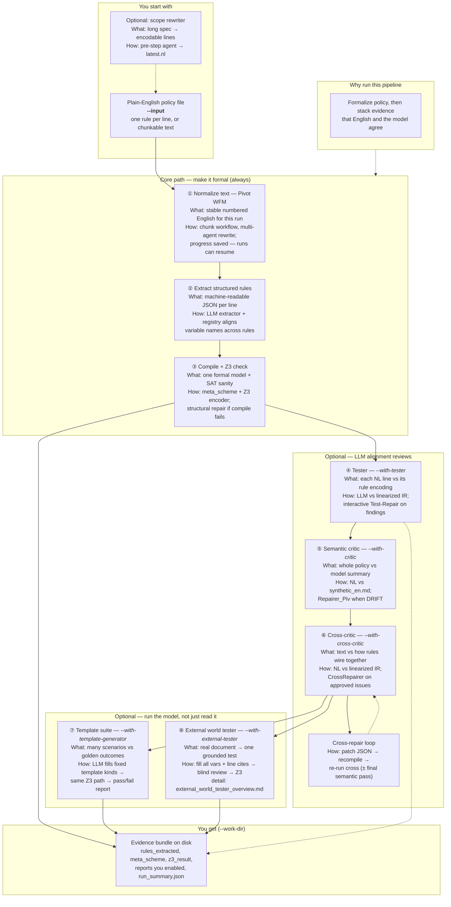

# Pivot pipeline — end-to-end overview (diagram)

**Audience:** Someone new to the project.  
**Value in one line:** Turn plain-English policy into a **checkable formal model**, then **layer evidence** that the model matches what you meant.

---

## How to get a picture from this file

1. Open **[mermaid.live](https://mermaid.live)** (or GitHub preview of this `.md` file).
2. Copy **only** the diagram code below (from `flowchart TB` through the last line of the diagram, **without** the ` ```mermaid ` fences if the site asks for raw Mermaid).
3. Paste into the editor → diagram renders → **Export PNG/SVG** from the menu.

**Alternate:** Copy the contents of [`pipeline_e2e_overview.mmd`](pipeline_e2e_overview.mmd) (pure Mermaid, no Markdown).

**More detail:** [`../ARCHITECTURE.md`](../ARCHITECTURE.md) (full diagram with CLI flags).

---

## Step-by-step reference (same content as diagram nodes)

The Mermaid chart below puts **What / How** on each box. This section repeats it for readers who prefer prose or screen readers.

## What happens along the way (steps ①–⑧)

The pipeline is mostly **sequential**: you need a compiled model (③) before alignment checks and executable tests mean anything. Stages ④–⑥ are **LLM-assisted reviews** with optional **repair loops** in interactive mode—you can approve fixes or waive issues and continue. They add evidence on top of ①–③; they do not replace formalization.

**Optional before ① — scope rewriter**  
*What:* A pre-step when the source is a long Markdown spec, not already one-rule-per-line.  
*How:* An agent rewrites the document into encodable rule lines (`latest.nl`) and records what changed; pivot then uses that file as `--input`.  
*Why:* Same policy intent, shaped for the chunk workflow below.

---

### ① Normalize text (Pivot WFM)

*What’s going on:* Raw policy becomes **stable, numbered English** the rest of the pipeline treats as authoritative.  
*How:* Text is processed **in chunks** through a fixed multi-agent workflow (clarify wording, decompose into atomic lines, scope checks). Progress and handoffs are saved so a failed run can **resume**.  
*You get:* `phase0_normalized_nl.txt`, chunk logs, WFM handoffs under `work_dir`.

---

### ② Extract structured rules

*What’s going on:* Each English line becomes a **machine-readable rule** (conditions, thresholds, exceptions) using a small set of template shapes.  
*How:* An extractor (typically LLM) emits JSON; a **registry pass** **aligns variable names** across rules. Interactive mode can retry or drop bad lines.  
*You get:* `rules_extracted.json` — the frozen rule list for this run.

---

### ③ Compile + Z3 check

*What’s going on:* Rules become a **formal model** the solver can reason about.  
*How:* The compiler builds `meta_scheme.json` and a Z3 encoding. Z3 checks whether the model admits **any** consistent assignment (SAT). On compile failure, **structural repair** may patch rule shape and retry. Precheck adds light heuristics (e.g. constants that never appear in source text).  
*You get:* `meta_scheme.json`, `z3_result.json`, `synthetic_en.md`, `precheck.json`.

---

### ④ Tester (optional, `--with-tester`)

*What’s going on:* **Per-rule** alignment — does each line of processed NL match how that rule was encoded?  
*How:* An LLM compares NL to a **linearized assessment view** of the IR (readable rule list, not raw JSON). Interactive mode can run **Test-Repairer** on approved findings (patch cited rules, merge, re-test).  
*You get:* `tester_report.json` (+ repair traces if used).  
*Value:* Catches wrong operators, thresholds, or variables on specific lines.

---

### ⑤ Semantic critic (optional, `--with-critic`)

*What’s going on:* **Whole-policy** alignment — does the normalized English **mean the same thing** as the model’s English summary?  
*How:* The pipeline writes `synthetic_en.md`; a critic LLM compares it to effective NL. **DRIFT** signals a material mismatch; **Repairer_Piv** can edit rules under interactive gates, then the critic re-runs.  
*You get:* `critic_report.json`, optional drift handoff files.  
*Value:* Catches global misreadings (wrong outcome, missing exception) that per-line tester might miss.

---

### ⑥ Cross-critic (optional, `--with-cross-critic`)

*What’s going on:* **Structural** alignment — does the policy text match **how rules connect** in the IR (aggregates, k-of-n, preemption, shared booleans)?  
*How:* An LLM sees processed NL plus `linearized_model_for_cross_critic.txt`. **CrossRepairer** applies small approved patches; interactive triage selects which findings to fix.  
*You get:* `cross_critic_report.json`, repair traces.  
*Value:* Catches wiring bugs like “downstream rule reads a flag the upstream rule never sets.”

**Cross-repair loops** (in the diagram): re-compile and re-run ⑥ (and sometimes a final semantic pass) after automated edits—same repair pattern as elsewhere (focused patches, merge, registry retry).

---

### ⑦ Template suite (optional, `--with-template-generator`)

*What’s going on:* **Executable checks** on the compiled model — “given this world, what does the policy say?”  
*How:* You supply a suite or an LLM **fills predefined template kinds** (scenarios, boundaries, decision queries) with worlds and golden outcomes. Each instance runs through the **same Z3 path**; results are diffed.  
*You get:* `template_run_report.json` (pass / fail / inconclusive per test).  
*Value:* Exercises the living model; useful sanity check beyond text-vs-JSON agreement.

---

### ⑧ Policy case pipeline (optional, `--with-external-tester`)

*What’s going on:* One case from **real unstructured text** (not LLM-invented worlds).  
*How:* World builder extracts **stated** facts + explicit **unknown** → Z3 witness for **derived** → blind provenance on stated only → Z3 decides **compatible / incompatible** (no golden). Detail: [`external_world_tester_overview.md`](external_world_tester_overview.md).  
*You get:* `policy_case_report.json` (alias `external_tester_run_report.json`), `policy_case_query_addendum.json` (strict + lenient existential check), `policy_case_explanation.json`, provenance audit files.  
*Value:* Live-data exercise; strict compatibility (CWA on gaps) plus lenient witness for unknowns when a completion exists.

---

### Outputs (always)

Artifacts under **`--work-dir`**: structured rules, compiled scheme, solver result, enabled reports, and **`run_summary.json`** (ok, warnings, or blocked). That folder is the **evidence bundle** for what was formalized and how it was checked.

---

## Diagram (copy below into mermaid.live)


