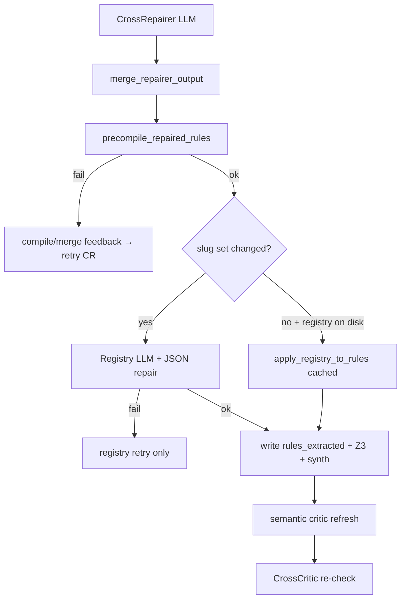

# Dev plan: CrossRepairer hardening — payload, merge, prompt, registry, error routing

**Status:** Implemented  
**Priority:** P1 (cross repair JSON parse failures + registry JSON noise on large policies)  
**Related run:** `NagV/exports/pivot_runs/recruitment_16_temp_wfm` — `cross_repairer_trace.jsonl`, `cross_repair_handoff.json`  
**Prerequisite (done):** `dev_plan_cross_critic_finding_triage_v1.md` (selective approved findings)  
**Prerequisite (done):** `dev_plan_pivot_test_repairer_hardening_v1.md` (shared patterns to reuse)  
**Related:** `dev_plan_pivot_cross_critic_cross_repairer.md` (base CrossCritic / CrossRepairer slice)

---

## 1. Problem (simple terms)

After CrossCritic ISSUES and operator triage, **CrossRepairer** should apply **small, approved** cross-rule fixes, **compile**, optionally **registry**, then re-run semantic critic + CrossCritic.

**What goes wrong today (representative, any large policy):**

| Symptom | Likely cause |
|---------|----------------|
| `CrossRepairer failed: Expecting property name enclosed in double quotes` (line ~1000+) | Model asked to **re-emit entire `rules` JSON** (~37 rules); output truncated or syntactically invalid |
| `Registry after cross repair failed: Expecting ',' delimiter` | **Registry LLM** returned bad JSON — repairer may have succeeded |
| Invented rule ids (`R0029_a`) in trace | Thin prompt + full-policy rewrite scope |

**Structural gaps (mirror pre-hardening Test-Repairer):**

1. **Payload:** full rules array every attempt — no `focus_rule_ids` / stubs.
2. **Output:** no server **merge** — LLM must return complete policy JSON.
3. **Prompt:** `cross_repairer.md` only — no shared `repairer_ir_normative.md`, no cross addendum (no “do not invent rule_id”, patch-only discipline).
4. **Order:** registry runs **before** local pre-compile — registry noise masks Pydantic errors.
5. **Feedback:** registry parse errors surface as generic `CrossRepairer failed` or `Registry after cross repair failed` with no **stage** distinction; repairer retry does not get **compile** or **merge** text.
6. **Registry:** single `registry_pass_from_nl_and_rules` call — no JSON repair loop (already exists as `run_registry_pass_with_repairs` but **not wired** on cross path).

**Goal:** CrossRepairer behaves like hardened Test-Repairer: **edit few rules, merge back, compile first, registry with repair/skip, honest retries.**

---

## 2. Approved scope (fixes 1–6)

Maps to user-facing “fixes 1–6”:

| User fix # | Plan ID | One line |
|------------|---------|----------|
| 1 | **F1** | Focused payload — full bodies for cited rules, stubs for rest |
| 2 | **F2** | Server merge — LLM patches focus ids only |
| 3 | **F3** | Prompt stack — shared normative IR + cross addendum |
| 4 | **F4** | Pre-compile before registry |
| 5 | **F5** | Parse/compile/merge errors fed back on repairer retry |
| 6 | **F6** | Registry JSON repair + slug-unchanged skip |

**Optional P2 (not in 1–6):** separate registry vs repairer attempt counters (`F7`); API 503 does not consume repair attempt (`F8`).

---

### F1 — Focused rules payload (stubs for unchanged rules)

**Problem:** Full ~1k-line `rules_extracted.json` in every CrossRepairer prompt and expected output.

**Design:**

1. Reuse or extend `test_repair_rules_payload.py`:
   - `focus_rule_ids_from_cross_handoff(handoff)` — collect ids from `handoff.findings[]`: `rule_ids[]`, `explanation`, `recommendation` (regex `R\d{4,}`), same as tester.
   - `build_rules_payload_stubs(full_rules, focus_rule_ids)` — **shared** implementation.
2. CrossRepairer payload adds:

```json
{
  "focus_rule_ids": ["R0030", "R0031", "R0033", "R0036", "R0037"],
  "rules": [ /* full or stub */ ]
}
```

3. Prompt: output **complete** `rules` array; **only edit** `focus_rule_ids`; echo stubs unchanged.

**Acceptance:** Unit test — 37-rule fixture, focus 5 → serialized `rules` in prompt materially smaller than full dump.

---

### F2 — Server-side merge (patch, not full file)

**Problem:** Parser fails on huge LLM-generated JSON even when only 2–4 rules changed.

**Design:**

1. Reuse `merge_repairer_output(full_rules, repairer_rules, focus_rule_ids)` from `test_repair_rules_payload.py`.
2. `run_cross_repairer()` flow:

```text
out = LLM(...)
merged = merge_repairer_output(full_rules=rules, repairer_rules=out.rules, focus_rule_ids=focus)
out.rules = merged
```

3. Reject **unknown** rule ids in repairer output (`MergeRepairerOutputError`) — no `R0029_a` unless already in policy (if ever allowed, explicit product decision).

**Acceptance:** Merge test — edit R0037 only; other 36 rules byte-identical to input.

---

### F3 — Prompt stack (normative IR + cross addendum)

**Problem:** CrossRepairer invents templates, new rule ids, or broad rewrites across unrelated rules.

**Change:**

| Piece | File |
|-------|------|
| Shared cookbook | `prompts/repairer_ir_normative.md` (already exists — **append**, do not fork) |
| Cross-specific | New `prompts/cross_repairer_ir_addendum.md` |
| Composer | `cross_repairer_system_prompt()` in `cross_repairer_agent.py` |

**`cross_repairer_ir_addendum.md` bullets (normative, not policy-specific):**

- **Patch-only:** address `handoff.findings` / `approved_finding_ids` only; ignore `ignored_finding_ids`.
- **No new `rule_id`** unless compile-required dependency (rare); never suffix ids (`R0029_a`).
- **Cross-family edits:** unify variables **within the finding’s `rule_ids`** (escalation family, rejection family) — do not rewrite unrelated numeric/K_OF_N rules.
- **Prefer variable alignment** over adding aggregate definition rules unless finding explicitly requires aggregation and NL supports it.
- **Output JSON:** strict `{ "rules", "change_summary" }`; valid JSON only; every `change_summary[].finding_id` ∈ `approved_finding_ids`.
- Append **vNext** + **temporal** repair appendices via shared helper from `repairer_piv_agent.py` (same as test repairer).

Update `cross_repairer.md` rule 2 to state `handoff.findings` is pre-filtered (already partial).

**Acceptance:** Prompt assembly test — output string contains `repairer_ir_normative` content and “do not invent rule_id”; manual review.

---

### F4 — Pre-compile before registry

**Problem:** Registry runs on possibly invalid IR; user sees registry JSON errors when rules never compiled.

**Design:**

After F2 merge in `run.py` cross REPAIR branch (or new `cross_repair_apply.py`):

```python
from pivot_pipeline.tester_repairer_agent import precompile_repaired_rules  # or shared helper

sanitized = precompile_repaired_rules(policy_id, merged)
# on fail → error_stage rules_compile, feed F5, continue gate (no registry)
new_rules = sanitized
```

- Do not write `rules_extracted.json` / `rules_after_cross_repair.json` until compile succeeds.
- Optional: `sanitize_dropped_keys` in `cross_repairer_trace.jsonl`.

**Acceptance:** Mock repairer returns illegal top-level field → pre-compile fails with Pydantic message; registry LLM not called.

---

### F5 — Error feedback on repairer retry

**Problem:** JSON parse retry is generic; compile/merge failures do not sharpen the next LLM call.

**Design:**

Mirror Test-Repairer payload fields:

| Field | When set |
|-------|----------|
| `compile_validation_error` | `rules_compile` after pre-compile |
| `merge_validation_error` | `MergeRepairerOutputError` |

Use existing suffixes from `repairer_piv_agent.py`:

- `_compile_error_prompt_suffix`
- New or shared `_merge_error_prompt_suffix` (test repairer has merge suffix — reuse)

**Cross-repair loop (`run.py` or `cross_repair_interactive.py`):**

- On repairer JSON parse fail: existing `complete_repairer_prompt` retry (unchanged).
- On merge fail: set `merge_validation_error`, **re-call** `run_cross_repairer` without incrementing “success” round (same pattern as tester inner compile loop).
- On compile fail: set `compile_validation_error`, retry repairer.
- **Do not** pass registry JSON errors as `compile_validation_error` (F6).

**Handoff extension (optional):**

```json
{
  "last_repair_error_stage": "rules_compile",
  "last_compile_validation_error": "...",
  "last_merge_validation_error": "..."
}
```

v1.1 resume cross-repair from handoff — document only unless trivial.

**Acceptance:** Mock compile fail → second repairer prompt contains validation excerpt; registry mock not invoked.

---

### F6 — Registry JSON repair + skip when slugs unchanged

**Problem:** `Registry after cross repair failed: Expecting ',' delimiter` burns user patience; repairer work may already be valid.

**Design:**

New thin module `cross_repair_registry.py` (mirror `test_repair_registry.py`) or **reuse** test helpers with cross-specific env prefixes:

**P6a — Wire `registry_pass_from_nl_and_rules_with_repairs`**

- Replace `registry_pass_from_nl_and_rules` in cross REPAIR branch.
- Env: reuse **`PIVOT_REGISTRY_JSON_REPAIR_MAX`** (already global).
- New env **`PIVOT_CROSS_REPAIR_REGISTRY_ATTEMPTS`** (default **3**, clamp 1–10) — registry tries per successful compile.

**P6b — Skip registry when slug set unchanged**

- `can_reuse_cached_registry(rules_before, rules_after, work_dir, cli_skip_registry)` — **same logic** as test repair.
- Log: `[policy gate] Registry skipped (slug set unchanged); reusing identifier_registry.json`.
- Env **`PIVOT_CROSS_REPAIR_SKIP_REGISTRY`** (default 0) — dev override.

**Error staging (with F5):**

| `error_stage` | User prefix | Retry repairer? | Retry registry only? |
|---------------|-------------|-----------------|----------------------|
| `repairer_json` | CrossRepairer output parse failed | JSON recovery | No |
| `repairer_api` | CrossRepairer failed (API) | Optional | No |
| `rules_merge` | Cross-repair merge failed | Yes (merge suffix) | No |
| `rules_compile` | Cross-repaired rules did not compile | Yes (compile suffix) | No |
| `registry_json` | Registry pass failed (invalid JSON) | **No** | Yes (F6a) |
| `registry_api` | Registry pass failed (API) | No | Yes |

**Acceptance:**

- Unit: invalid registry JSON fixed on attempt 2; repairer called once.
- Unit: slugs unchanged + `identifier_registry.json` exists → registry LLM not called.

---

## 3. Non-goals

- Changing CrossCritic finding schema or triage UX (`dev_plan_cross_critic_finding_triage_v1.md`).
- Merging CrossRepairer into Test-Repairer or Repairer_Piv (separate `mode` stays).
- Auto-implementing ignored findings.
- Unlimited automatic repair without user `REPAIR` (interactive gate unchanged).
- Fixing CrossCritic false positives (separate prompt work).

---

## 4. Architecture (after F1–F6)



### Prompt composition (F3)

```text
cross_repairer.md
  + repairer_ir_normative.md
  + cross_repairer_ir_addendum.md
  + vNext appendix (shared helper)
  + temporal_surrogates_addendum (shared)
```

---

## 5. Implementation tasks

| ID | Task | Files |
|----|------|-------|
| P0.1 | F3: `cross_repairer_ir_addendum.md` + `cross_repairer_system_prompt()` | `prompts/`, `cross_repairer_agent.py` |
| P0.2 | F3: Wire vNext/temporal appendices (shared export from `repairer_piv_agent`) | `cross_repairer_agent.py` |
| P1.1 | F1: `focus_rule_ids_from_cross_handoff()` (alias or wrapper) | `test_repair_rules_payload.py` or `cross_repair_rules_payload.py` |
| P1.2 | F1–F2: Update `run_cross_repairer()` — stubs payload + merge | `cross_repairer_agent.py` |
| P1.3 | F1–F2: Unit tests payload size + merge | `tests/test_cross_repair_rules_payload.py` |
| P2.1 | F4: Pre-compile gate in cross REPAIR branch | `run.py` |
| P2.2 | F5: `compile_validation_error` / `merge_validation_error` on retry | `cross_repairer_agent.py`, `run.py` |
| P2.3 | F5: `error_stage` in `cross_repairer_trace.jsonl` | `run.py` |
| P3.1 | F6: `cross_repair_registry.py` (or reuse `test_repair_registry` with mode param) | new module |
| P3.2 | F6: Wire `registry_pass_from_nl_and_rules_with_repairs` + slug skip | `run.py` |
| P4.1 | Tests: registry fail doesn’t re-call repairer; compile fail does | `tests/test_cross_repair_interactive.py` |
| P4.2 | Docs: README, ARCHITECTURE cross slice, env table | `README.md`, `ARCHITECTURE.md`, `.env.example` |
| P4.3 | Update `dev_plan_cross_critic_finding_triage_v1.md` cross-ref | dev_plans |

**Reuse checklist (avoid duplication):**

- `build_rules_payload_stubs`, `merge_repairer_output`, `MergeRepairerOutputError` — import from `test_repair_rules_payload.py`.
- `precompile_repaired_rules` — import from `tester_repairer_agent.py` or move to `repair_apply.py`.
- `run_registry_pass_with_repairs` — already in `registry_pass.py`.

---

## 6. Env / CLI summary (new)

| Variable | Default | Meaning |
|----------|---------|---------|
| `PIVOT_REGISTRY_JSON_REPAIR_MAX` | 3 | Registry output JSON repair attempts (shared) |
| `PIVOT_CROSS_REPAIR_REGISTRY_ATTEMPTS` | 3 | Registry pass tries per successful cross repair compile |
| `PIVOT_CROSS_REPAIR_SKIP_REGISTRY` | 0 | Force skip registry LLM on cross repair (dev) |
| `PIVOT_CROSS_REPAIR_COUNT_API_AS_ATTEMPT` | 0 | If 0, repairer 503 does not count as failed repair round |
| `PIVOT_CROSS_REPAIR_MAX_ROUNDS` | 0 | User REPAIR sessions (0 = unlimited; already shipped) |

CLI: existing `--skip-registry` on `pivot_pipeline` / `cross_coherence` — document interaction with slug skip.

---

## 7. Test plan

1. **Unit:** `focus_rule_ids_from_cross_handoff` — handoff with X001 listing R0030,R0037 → focus set correct.
2. **Unit:** stub payload smaller than full for 37-rule fixture.
3. **Unit:** merge — change one rule; others identical.
4. **Unit:** merge rejects unknown rule id `R9999`.
5. **Unit:** pre-compile fail → repairer prompt includes error; registry not called (mock).
6. **Unit:** registry JSON fail twice then succeed — repairer call count == 1.
7. **Unit:** slugs unchanged → registry LLM not called.
8. **Manual:** recruitment — triage approve X001 only → REPAIR → compiles or clear Pydantic message (not 1k-line JSON parse).

---

## 8. Risks

| Risk | Mitigation |
|------|------------|
| Cross finding lists many `rule_ids` → large focus set | Still smaller than 37 full rules; triage to approve subset |
| Repairer drops stub rules | Merge validator + merge error stage |
| Shared payload module coupling test/cross | Single `test_repair_rules_payload.py` with neutral name later (`repair_rules_payload.py`) — optional rename P2 |
| Aggregate-variable findings need many rules | Addendum: prefer editing listed ids only; optional `related_rule_ids` on CrossCritic schema later |
| Registry skip when slugs equal but rename needed | Only skip when slug **set** equal |

---

## 9. Rollout order

1. **F3 prompts** (low risk, immediate quality).
2. **F1 + F2 payload + merge** (biggest JSON parse win).
3. **F4 pre-compile** + **F5 error feedback**.
4. **F6 registry repair + skip**.
5. Docs + manual recruitment pass.

---

## 10. CLI examples (after implementation)

**Cross coherence with triage + hardened repair (unchanged entry):**

```powershell
.\.venv\Scripts\python.exe -m pivot_pipeline.cross_coherence `
  --work-dir NagV\exports\pivot_runs\recruitment_16_temp_wfm `
  --input NagV\exports\scope_rewriter\recruitment_16_temp_run\scope_rewriter\latest.nl `
  --skip-semantic-critic `
  --cross-coherence-skip-critic-gate `
  --with-cross-repair `
  --interactive-cross-coherence
```

**Triage:** `n` then `3,4` to repair only X001–X002.

**Dev: skip registry:**

```powershell
$env:PIVOT_CROSS_REPAIR_SKIP_REGISTRY = "1"
# or --skip-registry on CLI
```

---

## 11. Summary

| Fix # | ID | One line |
|-------|-----|----------|
| 1 | F1 | Stubs for non-focus rules — smaller prompt |
| 2 | F2 | Merge patches server-side — no full JSON retype |
| 3 | F3 | Shared IR cookbook + cross addendum |
| 4 | F4 | Compile locally before registry |
| 5 | F5 | Feed compile/merge errors into repairer retry |
| 6 | F6 | Registry JSON repair + skip when slugs unchanged |

**Expected outcome:** Interactive cross repair on large policies fails less on **JSON syntax** and **registry noise**; when IR is wrong, the model gets **small edits**, **normative shape rules**, and **actionable compile feedback**.
