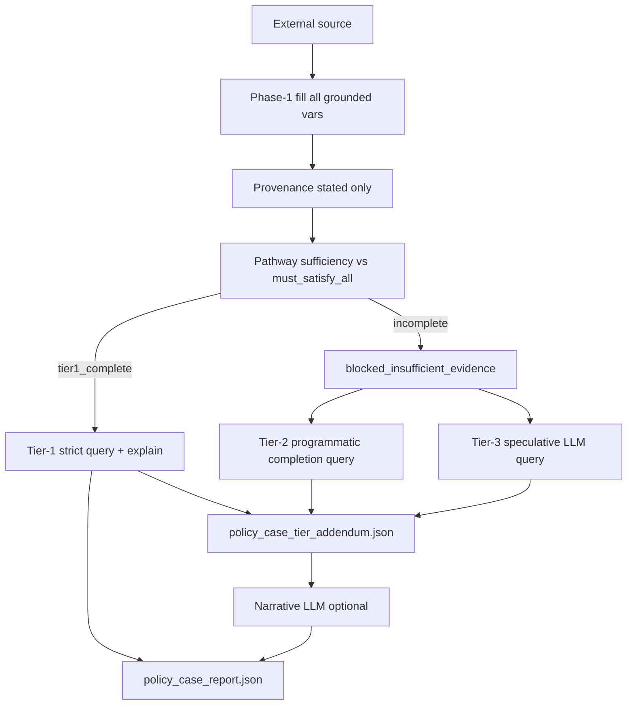

# Dev plan: External tester — pathway sufficiency gate + three-tier evaluation

**Status:** Planned  
**Priority:** P0 (external / policy-case product correctness)  
**Prerequisite:** `dev_plan_external_world_tester_v4_policy_world_pipeline_v1.md` (implemented); `dev_plan_policy_case_lenient_existential_query_v1.md` (implemented in code, **disabled by this plan** — see §9, §16)  
**Package:** `NagV/pivot_pipeline/external_tester/`  
**Reference policies:** `Backend_Engineer2_v1_wfm`, `policy_spec_wfm`, `recruitment_16_temp_wfm` (`meta_scheme.json` → `compiled_default.must_satisfy_all`)

---

## 1. Vision (one paragraph)

External sources (CV, email, form) are converted to a **partial world** with **provenance-checked stated facts**. Before any **strict pathway compatibility** verdict, a deterministic **pathway sufficiency** gate checks whether the document (plus optional user `case_scope`) supplies enough **grounded** evidence to evaluate the declared pathway (`must_satisfy_all` on `compiled_default`). If not → **`blocked_insufficient_evidence`** with a machine report and human-readable narrative — no false “incompatible candidate.” **Tier 1 (strict)** runs only on pathway-complete worlds. **Tier 2 (programmatic)** and **Tier 3 (speculative LLM)** run automatically afterward (or in parallel after tier-1 block), always labeled weaker: they show what would happen if missing values were filled by **rules/derive** or by **LLM guess**, with audit trails (tier 3 includes a **provenance-style audit report**, no provenance *verification*).

---

## 2. Problem / current gaps

| Gap | Symptom | Root cause |
|-----|---------|------------|
| **Tiny grounded surface** | Strong vs weak CV → identical strict/lenient summaries | `variable_tiers.py` treats bool atoms in `required_condition` as **derived**, not evidence; phase-1 only fills ~3 vars |
| **No sufficiency gate** | Z3 runs with CWA defaults while CV incomplete | `run.py` goes extract → provenance → query even when pathway untestable from document |
| **Lenient misread as pass** (legacy) | “compatible” under lenient while CV incomplete | Existential completion ≠ document sufficiency — **lenient disabled** in this plan (§9) |
| **Outcome vocabulary** | `incompatible` conflates “missing evidence” vs “fails policy” | `PolicyCaseReportV1.outcome` lacks `blocked_insufficient_evidence` |

**Agreed product model (user):**

- **`must_satisfy_all`** on the single compiled pathway = **complete evaluation scope** (all active rules ANDed in one Z3 world).
- **Pathway-complete** = every **grounded variable required by those rules** is resolved (per-rule OR / k-of-n patterns), not “every name in `variable_sorts`.”
- **Tier 2 / 3** are **automated weak signals** with reports; busy users see gaps + assumption outcomes without manual fill.

---

## 3. Three evaluation tiers

| Tier | Name | Automation | Input world | Z3 / logic | Provenance **check** | User-facing label |
|------|------|------------|-------------|------------|----------------------|-------------------|
| **1** | **Document strict** | Deterministic + existing provenance reviewer | Stated (+ user `case_scope`) only; **no** tier-2/3 values in pins | Strict query: **stated-only** pins; pathway must be sufficiency-complete first (no CWA at query) | **Yes** (stated only) | “Evaluated on extracted evidence” |
| **2** | **Programmatic completion** | Deterministic (`strict_eval`, K_OF_N, link fill, optional small rule set) | Stated + tier-2 **inferred** assignments (tracked separately) | Strict query on **completed** world; report lists each inferred var + rule/rationale | No | “Hypothetical: policy logic filled gaps” |
| **3** | **Speculative LLM** | LLM agent | Stated + tier-2 + tier-3 suggestions for **missing report vars only** | Strict query on **speculative** world; separate audit artifact | **Audit only** (quotes/lines returned, **no** blind review gate) | “Speculative: not verified against source” |

**Ordering (default):**

1. Phase-1 extract (all **grounded** vars, post tier fix) → provenance on stated.  
2. **Sufficiency report** vs `pathway_id=compiled_default` (configurable later).  
3. If tier-1 **incomplete** → outcome `blocked_insufficient_evidence`; **still run** tier 2+3 for diagnostic reports (env/flag to skip).  
4. If tier-1 **complete** → tier-1 strict compatibility + explanation.  
5. Always emit tier-2 and tier-3 bundles when enabled (see §7).

**Critical rule:** Tier-2/3 results **must not** upgrade tier-1 outcome. They appear only in `policy_case_tier_addendum.json` (and narrative), never as `compatibility` on the primary report without explicit user “accept suggestions” (P2).

---

## 4. Pathway sufficiency (new core module)

### 4.1 Module: `pathway_sufficiency.py`

**Responsibilities:**

1. Load `meta.evaluation_pathways[]` (default: `compiled_default`).  
2. For each `rule_id` in `must_satisfy_all`, compute **required grounded variables** from IR:
   - `LOGICAL_IMPLICATION`: trigger atoms + required atoms (bools included).
   - `CONSTANT_RELATIONAL`: `variable`.
   - `K_OF_N`: clause atoms; if `k < len(clauses)`, sufficiency = **at least k** clause vars **resolved** (not all OR branches).
   - `K_OF_N` + `result_variable`: clause vars + aggregate if used in downstream rules (v1: include `result_variable` when present).
3. Map rule → NL line via `identifier_registry.json` / rule_id order (best-effort pointer in report).
4. Compare against `PolicyCaseWorldV1`:
   - **Resolved:** stated `present|inferred` with provenance pass (tier-1) or user `case_scope`.
   - **Missing:** `unknown` or `not_found` or provenance-fail.
5. Emit `PathwaySufficiencyReportV1`.

**API sketch:**

```python
def compute_pathway_requirements(
    meta: MetaScheme, rules: list[dict], *, pathway_id: str = "compiled_default"
) -> PathwayRequirementsV1: ...

def assess_pathway_sufficiency(
    world: PolicyCaseWorldV1,
    requirements: PathwayRequirementsV1,
    *,
    provenance_ok_vars: set[str] | None = None,
) -> PathwaySufficiencyReportV1: ...
```

**`tier1_complete`:** `missing_for_pathway` empty and no `blocking_provenance` on required vars.

### 4.2 Fix: `variable_tiers.py`

Extend `_collect_evidence_vars` to include **bool** atoms in `required_condition` (remove `sort_filter="int"` only for consequents, or add parallel bool walk).

**Acceptance:** BE2 grounded count ≈ all skill/experience bools appearing in rule bodies, not 3.

**Files:** `variable_tiers.py`, tests in `test_external_tester.py` / new `test_pathway_sufficiency.py`.

---

## 5. Tier 2 — programmatic completion

### 5.1 Module: `tier_programmatic.py`

**Input:** `PolicyCaseWorldV1` (stated/unknown), `PathwaySufficiencyReportV1`, `rules`, `meta`.

**Behavior:**

1. Start from stated pins only.  
2. Apply existing **`evaluate_derived_strict`** (`derive_eval.py`) over full grounded+derived catalog.  
3. Optionally apply deterministic closure rules (document in report):
   - Link edges (`link_consistency.build_link_edges`): if trigger var set and consequent missing, do **not** auto-fill (too aggressive); only fill when `derive_eval` or explicit K_OF_N evaluation sets `result_variable`.
4. For each var filled that was **missing** in sufficiency report, append `ProgrammaticInferenceV1` `{ variable, value, source: "strict_eval"|"k_of_n"|..., rationale, rule_ids[] }`.
5. Run **strict** `run_policy_query` on completed world → `tier2_compatibility`, `tier2_z3_status`, `tier2_defaulted` (should be minimal).

**No LLM.** Report section: “If we infer X from given facts, pathway becomes compatible/incompatible.”

---

## 6. Tier 3 — speculative LLM

### 6.1 Module: `tier_speculative.py` + prompt

**Trigger:** After sufficiency report; input = source text + `missing_for_pathway` list + catalog excerpt + rule glossary snippet.

**Prompt:** `prompts/external_case_speculative_fill.md`

**Output schema:** `SpeculativeFillV1`

```json
{
  "schema_version": "1",
  "suggestions": [
    {
      "variable": "years_backend_experience",
      "sort": "int",
      "value": 4,
      "confidence": "medium",
      "provenance_audit": {
        "line_numbers": [9, 25],
        "quotes": ["March 2022 – Present", "July 2020 – February 2022"],
        "rationale": "Sum of roles suggests ~4 years total; not explicit in document."
      },
      "basis": "heuristic_from_dates"
    }
  ]
}
```

**No provenance reviewer** on tier-3 fields. Write `policy_case_speculative_audit.json` (audit trail for operators).

**Query:** Merge suggestions into a **copy** world (`speculative_world`); run strict Z3; store `tier3_compatibility` separately.

**Optional env:** `PIVOT_CASE_TIER3=off` for cost/latency.

---

## 7. Human-readable layer

### 7.1 Module: `case_narrative_agent.py` (or extend `explainer`)

**Input:** sufficiency report + tier1/2/3 results + source metadata.

**Output:** `policy_case_narrative.md` — plain language:

- What is missing for a **real** evaluation (tier 1).
- What programmatic assumptions would change (tier 2).
- What LLM guessed (tier 3) with cited lines **for audit only**.

**Prompt:** `prompts/external_case_narrative.md`

**No gate on narrative** (display-only).

### 7.2 User resubmission

- **`case_scope`** on `ExternalSourceEnvelope` already merges grounded vars (`world_builder.merge_case_scope_into_stated`).  
- Document CLI: `--case-scope-json` or interactive refill file.  
- Re-run pipeline: sufficiency → tier1 when complete.

---

## 8. Pipeline orchestration (`run.py`)

### 8.1 New flow



### 8.2 `PolicyCaseReportV1` extensions (`schemas.py`)

```python
outcome: Literal[
  "complete",
  "blocked_insufficient_evidence",  # NEW primary when tier1 incomplete
  "blocked_provenance",
  "blocked_query",
  "error",
]
pathway_id: str = "compiled_default"
tier1_complete: bool
sufficiency_report_path: str | None
tier_addendum_path: str | None
narrative_path: str | None
# tier1 compatibility/z3 only when tier1_complete
compatibility: ... | None  # unchanged semantics
```

Primary report fields `lenient_*` / `dual_query_summary` / `strict_incompatible_lenient_compatible` are **omitted or null** when lenient is off (§9).

---

## 9. Lenient existential query — **tabled** (deferred)

**Decision (point 3):** Do **not** run `run_lenient_policy_query` in the default external-case pipeline for this workstream. Code in `policy_query.py` remains; reinstate later via flag if operators want a fourth “∃ witness” diagnostic.

| Mechanism | Role in this plan |
|-----------|-------------------|
| **Tier-1 strict** (`run_policy_query`, **stated-only** pins) | **Only** primary compatibility verdict when sufficiency complete. |
| **Tier-2 programmatic** | Weak automated signal: rule-based gap fill + strict re-query + `policy_case_programmatic_fill.json`. |
| **Tier-3 speculative LLM** | Weaker automated signal: LLM suggestions for missing vars + audit JSON + strict re-query. |
| **Lenient existential** (`run_lenient_policy_query`) | **Not run** (default). Optional future: `--enable-lenient-query` or `PIVOT_CASE_LENIENT_QUERY=on`. |
| **World builder `derived[]`** | Populated for tier-2 / artifacts; **not** pinned in tier-1 Z3. |

**Implementation note:** In `run.py`, gate existing lenient block behind env default **off**; stop printing `dual_query_summary` in the default CLI summary. Do not remove `policy_query.py` helpers.

**Why tabled:** Tier-2 already exposes “what if we fill gaps?” with auditable steps; lenient’s existential witness overlapped that role and confused operators. Revisit if tier-2 is insufficient.

**Migration:** Today’s **strict** query uses stated + derived + CWA — tier-1 implementation replaces that with stated-only + sufficiency gate (§16.1).

---

## 10. Artifacts (work dir)

| File | Content |
|------|---------|
| `policy_case_sufficiency.json` | `PathwaySufficiencyReportV1` |
| `policy_case_tier_addendum.json` | tier2 + tier3 only (no lenient section while tabled) |
| `policy_case_speculative_audit.json` | LLM suggestions + provenance_audit |
| `policy_case_programmatic_fill.json` | programmatic inferences list |
| `policy_case_narrative.md` | human summary |
| `policy_case_report.json` | primary outcome (tier-1 gate) |
| `policy_case_world.json` | stated/unknown/derived (tier-1 world only) |
| `external_tester_trace.jsonl` | sufficiency + tier events |

---

## 11. CLI / env flags

| Flag / env | Default | Meaning |
|------------|---------|---------|
| `--pathway-id` | `compiled_default` | Sufficiency + query scope |
| `--skip-tier2` | false | Diagnostic only tier-1 |
| `--skip-tier3` | false | No speculative LLM |
| `--skip-narrative` | false | No narrative LLM |
| `PIVOT_CASE_RUN_TIERS_ON_BLOCK` | `on` | Run tier2/3 when tier-1 blocked |
| `PIVOT_CASE_TIER3` | `on` | Speculative agent |
| `PIVOT_CASE_LENIENT_QUERY` | `off` | **Tabled:** existential lenient (re-enable later) |
| `--enable-lenient-query` | false | CLI opt-in to reinstate lenient block |

---

## 12. Implementation phases

### P0 — Sufficiency + tiers fix (no new LLM)

- [ ] `variable_tiers.py`: bool consequent atoms → grounded.  
- [ ] `pathway_sufficiency.py` + `PathwaySufficiencyReportV1` schema.  
- [ ] Wire `run.py`: after provenance PASS, sufficiency assess; set `blocked_insufficient_evidence`.  
- [ ] **Disable lenient existential** in default `run.py` path (`PIVOT_CASE_LENIENT_QUERY=off`); omit `dual_query_summary` from default terminal JSON.  
- [ ] Expand phase-1 batches to all grounded vars (automatic once tiers fixed).  
- [ ] Tests: BE2 meta, mock world missing `years_backend_experience` → blocked; complete world → tier1 query.  
- [ ] `link_consistency`: promote critical missing links to sufficiency errors (optional P0).

### P1 — Tier 2 programmatic report

- [ ] `tier_programmatic.py` + `policy_case_programmatic_fill.json`.  
- [ ] Tier-2 strict query on completed world; addendum section.  
- [ ] Tier-1 strict stated-only pins (`world_to_z3` / `run_policy_query` split).

### P2 — Tier 3 speculative + audit

- [ ] Prompt + `tier_speculative.py` + `SpeculativeFillV1` schema.  
- [ ] `policy_case_speculative_audit.json`.  
- [ ] Tier-3 query + addendum.

### P3 — Narrative + UX

- [ ] `case_narrative_agent.py` + prompt.  
- [ ] Terminal summary lines per tier.  
- [ ] Docs: `NagV/pivot_pipeline/README.md` or `ARCHITECTURE.md` external case section.  
- [ ] `--case-scope-json` helper for user refill.

---

## 13. Tests (acceptance)

1. **BE2 weak CV** (`backend_engineer_cv2.txt`): tier-1 `blocked_insufficient_evidence`; sufficiency lists `years_backend_experience` + skill vars; tier-2/3 reports emitted; **no** tier-1 `compatible`.  
2. **BE2 strong CV**: tier-1 complete → strict `compatible` or `incompatible` based on real pins (not identical to weak if years inferred).  
3. **Regression:** provenance fail still `blocked_provenance`; `require_prior_critics` unchanged.  
4. **Recruitment meta:** sufficiency scales to large `must_satisfy_all` (performance: requirements computed once per meta, cached in work dir).

---

## 14. Non-goals (v1)

- Multiple named pathways in one run (only `compiled_default`; `pathway_id` param is future-proof hook).  
- Per-rule pathways (`must_satisfy_all: ["R0001"]` only) as product mode.  
- Auto-promote tier-3 suggestions to stated without user action.  
- Provenance **verification** on tier-3 (audit JSON only).  
- DB-backed variable fill (schema documents requirement only).  
- Lenient existential in default pipeline (deferred — §9).

---

## 15. Files to touch (summary)

| Area | Files |
|------|--------|
| Sufficiency | **new** `pathway_sufficiency.py`, **new** `tests/test_pathway_sufficiency.py` |
| Tiers | `variable_tiers.py`, `fill_batches.py` (no change if tiers fix suffices) |
| Tier 2 | **new** `tier_programmatic.py` |
| Tier 3 | **new** `tier_speculative.py`, **new** `prompts/external_case_speculative_fill.md` |
| Narrative | **new** `case_narrative_agent.py`, **new** `prompts/external_case_narrative.md` |
| Orchestration | `run.py`, `schemas.py`, `trust.py` (unchanged gate), `policy_query.py`, `world_to_z3.py` |
| Docs | **this plan**, cross-ref v4 + lenient plans |

---

## 16. Resolved decisions (all points)

| # | Topic | Resolution |
|---|--------|------------|
| **1** | **Tier-1 inputs** | **Stated only**, after provenance pass: only variables the extract LLM marked as discovered from the source (`present` / `inferred` with line cites). No derived pins in tier-1 Z3. No CWA false/0 for pathway requirements at query — sufficiency gate first; gaps → `blocked_insufficient_evidence`. **Not an open product question;** implementation must change today’s strict query (stated+derived+CWA) in P0/P1. |
| **2** | **Tier-2/3 when tier-1 blocked** | **Yes.** Default `PIVOT_CASE_RUN_TIERS_ON_BLOCK=on`. Emit tier-2 and tier-3 reports and narrative even when tier-1 is incomplete. Flag/`--skip-tier2` / `--skip-tier3` to disable. |
| **3** | **Lenient existential** | **Tabled for this workstream.** Do not run in default pipeline. Weak diagnostics = **tier-2** (programmatic) + **tier-3** (speculative LLM) only. `run_lenient_policy_query` and lenient plan stay in repo for optional reinstatement (`PIVOT_CASE_LENIENT_QUERY=on` or `--enable-lenient-query`). |
| **4** | **Sufficiency OR-rules** | v1 = “≥ k of n clause vars resolved” for `K_OF_N`; document `k=1` OR edge cases. |

### Reinstatement checklist (lenient — later, if needed)

- [ ] Confirm tier-2/3 reports do not duplicate the operator question lenient answered.  
- [ ] Re-enable behind explicit flag; keep out of primary `compatibility` / `dual_query_summary`.  
- [ ] Addendum section `lenient_existential` optional, separate from tier-2.

---

*End of plan.*
