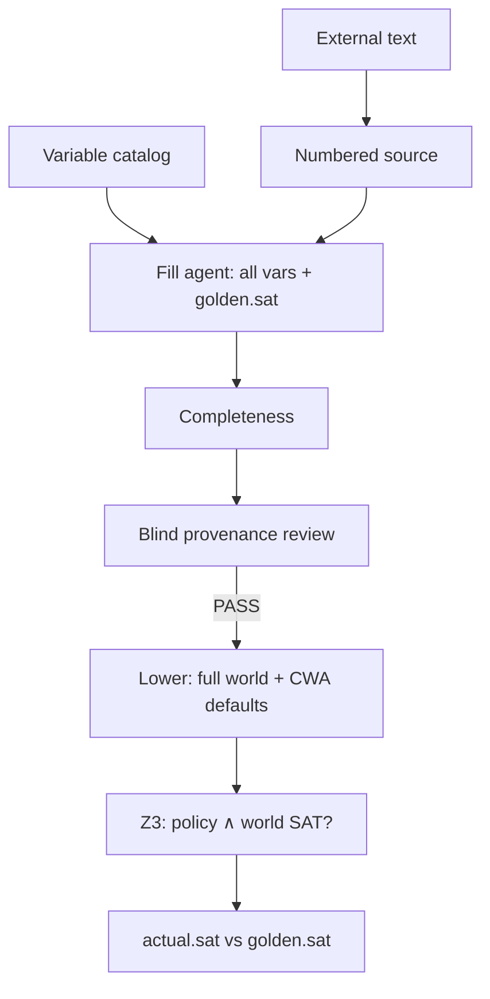

# Dev plan: External world tester v2 — global policy compatibility (`scenario` + closed-world defaults)

**Status:** Implemented  
**Priority:** P1  
**Supersedes (behavior):** v1 default in `dev_plan_external_world_tester_v1.md` §5.4, §12 (single `decision_query`, free `not_found` vars)  
**Prerequisite:** v1 implemented (`NagV/pivot_pipeline/external_tester/`, bool Z3 encoding fix in `z3_compile.py`)  
**Related:** `dev_plan_executable_test_templates_v1.md` (`scenario` template), `diagrams/external_world_tester_overview.md`

---

## 1. Problem (simple terms)

**Operator intent (confirmed):** Given unstructured external text, extract grounded variable values, then ask:

> “Under a **fixed reading** of that case (including conservative defaults for what the document did **not** say), does the **whole compiled policy** admit **any** satisfying assignment?”

i.e. **policy ∧ world** is **SAT** (compatible) vs **UNSAT** (contradicts the policy model) — **not** “is one LLM-chosen rule satisfied?”

**v1 gap:**

| Intent | v1 today |
|--------|----------|
| Whole-policy check | Single `decision_query` on fill-picked `rule_id` |
| Unmentioned → fixed default (ASP/CWA style) | `not_found` → variable **omitted** (Z3 free) |
| Pass = case fits model | Pass = one rule satisfied in **some** completion |

v1 remains valuable for provenance; v2 changes **only the executable question** and **world lowering semantics**.

---

## 2. Approved v2 behavior (closed scope)

### 2.1 Default executable test = `scenario`

After provenance review **PASS**:

1. Lower fill → `ScenarioInstance` with `world` + `golden: { "sat": true | false }`.
2. Run existing `execute_instance` + `diff_instance` (`scenario` branch).
3. Report:
   - `verdict`: pass | fail | inconclusive | error
   - `actual.sat` vs `golden.sat`
   - `world_semantics`: documented below
   - `world_coverage`: asserted / defaulted / total

**Golden meaning:**

| `golden.sat` | Operator reading |
|--------------|------------------|
| `true` | “This case should be **compatible** with the full policy.” |
| `false` | “These facts should **contradict** the policy (no satisfying completion).” |

Fill agent authors `golden.sat` from the document (and stated defaults policy below). Reviewer still **does not** see golden.

**No `query.rule_id` in v2 default path.** Remove fill-agent duty to pick a rule (prompt + validation).

### 2.2 Closed-world defaults for `not_found` (CWA-style)

When lowering to Z3 `world`, **every** catalog variable must appear:

| `status` | Z3 world value |
|----------|----------------|
| `present` | stated `value` |
| `inferred` | stated `value` |
| `not_found` | **default by sort** (see table) |

**Default table (v2 — configurable env, these are defaults):**

| Sort | Default when `not_found` | Rationale |
|------|---------------------------|-----------|
| `bool` | `false` | “Not mentioned” → not true |
| `int` | `0` | Conservative numeric absent (document in plan: may be strict) |

Env overrides (proposed):

- `PIVOT_EXTERNAL_NOT_FOUND_BOOL_DEFAULT=false`
- `PIVOT_EXTERNAL_NOT_FOUND_INT_DEFAULT=0`

**Important:** This is **not** full ASP; it is **explicit partial-world + defaults** before the same SMT `build_solver` AND-pathway. Document tradeoff: int `0` can mean “no experience” not “unknown” — operator may prefer later: enum `unknown` blocked at execute, or per-variable policy defaults file (P2).

Rename coverage stats:

```json
"world_coverage": {
  "from_document": 59,
  "defaulted_not_found": 35,
  "total": 94
}
```

### 2.3 Keep unchanged from v1

- Numbered source envelope
- Full catalog completeness (one row per `variable_sorts` key)
- Blind provenance reviewer (cited lines only)
- Fill ↔ review repair loops, 503 retry, syntax repair, trace jsonl
- No IR / policy repair from external test failure
- Domain-agnostic prompts (no CV/resume examples in code)

### 2.4 Legacy mode (optional, not default)

Preserve **`decision_query`** for debugging / rule-specific probes:

- CLI: `--external-test-mode decision_query` (+ `--external-query-rule` when set)
- Or env `PIVOT_EXTERNAL_TEST_MODE=decision_query`
- Behavior = current v1 lowering + validation

Default: `scenario` (or rename flag `--external-test-mode scenario`).

---

## 3. End-to-end flow (v2)



**Pass (test):** `golden.sat` equals `actual.sat` (both bool).  
**Fail (test):** mismatch (e.g. fill expected compatible, policy∧world UNSAT).  
**Inconclusive:** Z3 `unknown`.

---

## 4. Schema and API changes

### 4.1 `ExternalWorldFillV1` (v2)

- **Default** `template_kind`: `"scenario"`.
- **`query`**: optional; **forbidden** when `template_kind == "scenario"` (validate).
- **`golden`**: required shape:
  - scenario: `{ "sat": true | false }` only
  - decision_query (legacy): `{ "decision": "satisfied" | "unsatisfied" }` + `query`

### 4.2 `external_tester_run_report.json` (extend)

Add fields:

```json
{
  "test_mode": "scenario",
  "world_semantics": "closed_world_defaults_v1",
  "not_found_defaults": { "bool": false, "int": 0 },
  "actual": { "sat": true, "z3_status": "sat" },
  "golden": { "sat": true }
}
```

### 4.3 Fill prompt (`external_world_fill.md`)

Replace rule-picking instructions with:

- Predict whether the **full policy** can hold given assignments + defaults.
- Output `golden.sat` (not `golden.decision`).
- Explain in prompt: `not_found` → bool false / int 0 at execute time (fill must not leave vars out of `assignments`).

Remove example JSON that only shows `R0001` / `decision_query` as primary; keep legacy subsection “if mode decision_query”.

### 4.4 Reviewer prompt

Unchanged (still no golden). Optional addendum: “Do not judge whether the full policy is satisfied; only whether cited lines support each field value.”

---

## 5. Code changes (by module)

| Module | Change |
|--------|--------|
| `external_tester/schemas.py` | Validators: scenario forbids `query`; golden shape per mode |
| `external_tester/completeness.py` | Scenario golden checks; mode-aware |
| `external_tester/world_defaults.py` | **New:** `apply_not_found_defaults(assignments, sorts) -> world` |
| `external_tester/lower.py` | Use `world_defaults`; coverage stats rename |
| `external_tester/fill_agent.py` | Drop required `query_rule_id` from default prompt; `test_mode` param |
| `external_tester/run.py` | Default `test_mode=scenario`; report fields; CLI `--external-test-mode` |
| `external_tester/syntax_repair_agent.md` | Scenario golden repair hints |
| `prompts/external_world_fill.md` | v2 primary instructions |
| `cli.py` / `README.md` / `diagrams/external_world_tester_overview.md` | Document v2 default + semantics |
| `tests/test_external_tester.py` | CWA world size = total vars; scenario execute; legacy decision_query opt-in |

**`execute_z3.py` / `build_solver`:** no change (already supports scenario).

---

## 6. Implementation phases

### Phase A — World defaults + lowering (deterministic)

- [ ] `world_defaults.py` with env-configurable bool/int defaults.
- [ ] `world_from_assignments` → `build_executable_world(fill, meta)` returns **complete** map (all keys in `variable_sorts`).
- [ ] Unit tests: not_found bool→false, int→0; present unchanged; count == len(sorts).

### Phase B — Schema, completeness, fill prompt

- [ ] Default `template_kind` = `scenario`; validation rejects `query` on scenario.
- [ ] Update `check_completeness` for `golden.sat`.
- [ ] Rewrite `external_world_fill.md` (global compatibility narrative).
- [ ] `fill_agent`: remove rule list emphasis for default mode; optional compact policy excerpt only for “what SAT means” (1–2 sentences, no rule_id pick).

### Phase C — Run orchestration + report

- [ ] `run_external_tester_pipeline(test_mode="scenario")` default.
- [ ] `execute_after_review` sets `test_mode`, `world_semantics`, new coverage keys.
- [ ] CLI `--external-test-mode {scenario,decision_query}`; deprecate documenting `--external-query-rule` as scenario-only override for legacy.

### Phase D — Tests + docs

- [ ] Integration: mocked fill with `golden.sat: true` → execute passes/fails on toy policy+world.
- [ ] Toy UNSAT case: world forces violation → `actual.sat false` vs golden true → fail.
- [ ] Update `dev_plan_external_world_tester_v1.md` status note + link to v2.
- [ ] Update diagram nodes (What/How) for scenario + CWA.

### Phase E — P2 (out of scope unless quick)

- [ ] `PIVOT_EXTERNAL_NOT_FOUND_POLICY=strict` → fail execute if any `not_found` (force fill to infer or present).
- [ ] Per-policy defaults file (variable → default) from synthetic or operator config.
- [ ] Second reviewer pass on `golden.sat` only (no Z3) — optional.

---

## 7. Interpretation guide (for operators — ship in README)

**`actual.sat: true`:** There exists an assignment satisfying **all** active pathway rules **and** your world (including defaults).

**`actual.sat: false`:** No such assignment — the case **contradicts** the compiled policy under those defaults.

**Caveats (document honestly):**

1. **Compiled policy** is one AND pathway (v1 compiler), not “any path through NL pathways.”
2. **Int default 0** may over-reject (e.g. unstated years → 0 years).
3. **SAT ≠ approve** — only “model consistent”; NL policy intent still depends on earlier critic/tester gates.
4. **Golden `sat` from fill LLM** can be wrong; diff is “predicted compatibility vs Z3,” not ground truth hiring decision.

---

## 8. Success criteria (v2 done)

- [ ] Default run uses **`scenario`** only (no `query` in fill JSON).
- [ ] Z3 world includes **all** catalog variables; `not_found` uses configured defaults.
- [ ] Report explains `world_semantics` and `defaulted_not_found` count.
- [ ] Provenance review path unchanged and still gates execute.
- [ ] Legacy `decision_query` still works via explicit flag.
- [ ] Tests pass; recruitment-scale policy runs without encoder errors (bool fix retained).

---

## 9. Migration / rerun note

Existing `external_world_fill.json` from v1 runs are **not** compatible (contain `query` + `golden.decision`). Operators **re-run fill** after upgrade or use `--external-test-mode decision_query` for old artifacts.

---

## 10. Open decisions (defaults chosen)

| Question | v2 choice |
|----------|-----------|
| Default test mode | `scenario` |
| `not_found` int default | `0` (env override) |
| `not_found` bool default | `false` |
| Who sets `golden.sat`? | Fill agent (reviewer blind) |
| Block execute if any `not_found`? | No (P2 strict mode) |
| Multi-scenario per document? | No (one instance per run) |

---

*End of plan.*
