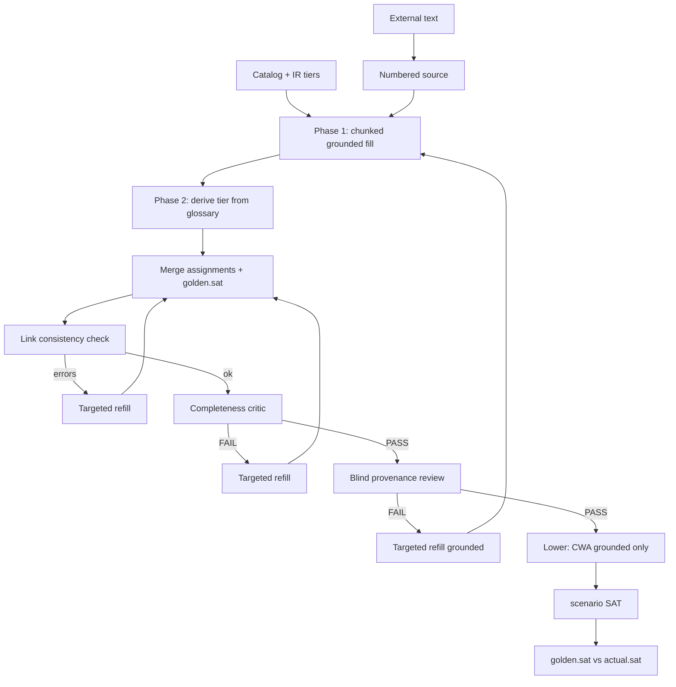

# Dev plan: External world tester v3 — fill orchestration (chunked, two-phase, critics, derived defaults)

**Status:** Implemented  
**Priority:** P1  
**Prerequisite:** v2 implemented (`scenario` default, `world_defaults.py`, `dev_plan_external_world_tester_v2_global_scenario_v1.md`)  
**Related:** `external_world_tester_overview.md`, `variable_catalog.py`, `pathway_compiler.py` / `meta_scheme.json`

---

## 1. Problem (simple terms)

v2 asks the right Z3 question (**policy ∧ world SAT**) and applies **closed-world defaults** (`not_found` → false / 0). Extraction quality is now the bottleneck:

| Symptom | Cause |
|---------|--------|
| Many `not_found` on fields the source supports | Single-shot fill over large catalogs; model fatigue / shallow pass |
| Derived / outcome flags left `not_found` | Same shot mixes “read document” with “apply policy structure” |
| Z3 **UNSAT** or misleading **fail** | Derived `not_found` lowered to **false** while IR also encodes those flags via implications or hard relational rules |
| `golden.sat` vs `actual.sat` mismatch | Fill predicts compatible; executed world is much stricter than intended reading |

**Operator intent (unchanged from v2):** After defensible extraction + defaults for **grounded** absence, does the **whole compiled policy** admit a satisfying assignment?

v3 improves **how the world is built** before the same v2 Z3 step. It does **not** change IR, pathway compiler, or `execute_z3` scenario semantics unless noted for **derived default policy** only.

---

## 2. Approved v3 behavior (closed scope)

### 2.1 Variable tiers (policy-agnostic, IR-derived)

Every catalog key gets a **tier** computed from `rules_extracted` / `MetaScheme` (no hand lists per domain):

| Tier | Meaning | Fill phase | `not_found` at execute (default) |
|------|---------|------------|-----------------------------------|
| **grounded** | Treated as evidence-bound: appears as measured/document-facing inputs in rules (constants, trigger atoms, K_OF_N clause inputs, numeric/bool slugs not rule outputs). | Phase 1 (chunked) | CWA: bool `false`, int `0` (v2 env overrides) |
| **derived** | Primarily **outputs** of rule structure: implication `required_condition` heads, K_OF_N / SUM assignees, `yields` targets that are not simple document counters, or variables only referenced as heads of logical rules. | Phase 2 only | **Do not default** — must be `present` or `inferred` before Z3, else **block execute** |

**Classification algorithm (deterministic):**

1. Collect all variable names from `meta.variable_sorts`.
2. Mark **derived_candidates**: variables that appear as the sole subject of `required_condition` atoms, K_OF_N `result` / assignee fields, or `CONSTANT_RELATIONAL` with `yields: SATISFIED` on bool flags that also appear as implication heads elsewhere.
3. Mark **grounded**: all others; optionally subdivide for batching (`int`, `bool`, enum-like `int` slugs from registry).
4. Persist in `variable_catalog.json` as `{ "name": "...", "sort": "...", "tier": "grounded|derived" }`.
5. Env override file (P2): operator can re-tag specific names without code change.

**Tier is advisory for prompts and execute policy, not a change to Z3 IR.**

### 2.2 Chunked fill — mini-prompt per family (Phase 1)

Replace one monolithic fill call with **sequential batches**:

- Split **grounded** catalog into batches of size `N` (default **12**, env `PIVOT_EXTERNAL_FILL_BATCH_SIZE`).
- Batch themes (deterministic order): `int` → `bool` → remaining grounded (stable sort by variable name within each sort).
- Each LLM turn receives:
  - Numbered source (full text)
  - Variable catalog excerpt **only for this batch**
  - Short policy context: 1–2 sentences (“variables belong to a compiled policy; cite lines”)
  - Instruction: output JSON fragment `{ "assignments": [ ... ] }` **only** for listed names; no `golden` in batch turns
- Merge batch outputs into `phase1_assignments`; validate no duplicates / missing within grounded set.

**Phase 1 must not assign derived tier variables** (validator strips or rejects if model returns them).

### 2.3 Two-phase fill

| Phase | Input | Output | Document read |
|-------|--------|--------|----------------|
| **1 — Grounded** | Source + catalog batches | `assignments` for grounded tier only | Yes (chunked) |
| **2 — Derive** | Phase 1 JSON + **rule glossary** | `assignments` for derived tier only | **No** (glossary only) |

**Rule glossary (compact, deterministic):**

- Build from `meta_scheme` / linearized assessment text if present; else generate from rules:
  - Per rule: `rule_id`, `template_class`, one-line linearized form (reuse backtranslate / existing linearizer hook if available).
  - Cap glossary size (e.g. 8k chars); no domain examples in code.
- Phase 2 prompt: given grounded facts, set each derived variable to `present` or `inferred` with rationale referencing **rule ids** and **phase 1 variables** (provenance for inferred may cite rule glossary + “from assignments X,Y”; line cites optional for pure derivations).

**Final assembly:**

- Concatenate phase 1 + phase 2 assignments → full `ExternalWorldFillV1`.
- **`golden.sat`**: set in a **final small LLM call** or end of phase 2 (source + full assignments summary only) — reviewer still blind to golden.

Persist artifacts:

- `external_world_fill_phase1.json`
- `external_world_fill_phase2.json`
- `external_world_fill.json` (merged)

### 2.4 Stricter validation (pre-Z3, deterministic)

New module **`link_consistency.py`** — no LLM:

Build a directed **link map** from IR:

- For each `LOGICAL_IMPLICATION`: each trigger atom variable → head variable(s) in `required_condition`.
- For each `CONSTANT_RELATIONAL` with `yields: SATISFIED`: variable → itself (hard constraint).
- For each K_OF_N / expansion lowering: clause variables → result assignee.

**Rules:**

- If variable **A** is `present` or `inferred` and link map has edge A → B, and **B** is `not_found` → emit `inconsistent_link: B depends on filled A`.
- If **B** is derived tier and `not_found` after phase 2 → emit `derived_incomplete: B`.

On any error: **do not execute Z3**; return `verdict: blocked_pre_execute` with `link_validation_errors[]`; trigger **targeted refill** (see §2.6).

Run after merge and after completeness critic loop (ordering in §3).

### 2.5 Completeness critic (LLM, non-Z3)

New agent **`completeness_critic`** (Pro model, separate prompt):

- **Sees:** merged assignments (all tiers), variable tiers, link map summary (optional), **no golden**, **no full source** (only cited quotes + line numbers per field from fill).
- **Task:** flag variables where `not_found` is inconsistent with other `present`/`inferred` fields (cross-field logic, not line-level provenance).
- **Output schema:** `ExternalCompletenessReviewV1`: `verdict` PASS|FAIL, `flagged_variables: [{ variable, reason }]`.

On FAIL: **targeted refill** — only flagged names:

- Grounded flags → mini phase-1 batch with source.
- Derived flags → phase 2 slice with glossary + current grounded snapshot.

Max rounds: env `PIVOT_EXTERNAL_COMPLETENESS_MAX_ROUNDS` (default 2), shared stall tracker pattern.

**Provenance reviewer unchanged** — still blind to golden; still cited-lines-only; runs after completeness PASS (or in parallel policy: completeness before provenance — see §3).

### 2.6 Targeted refill orchestration

| Trigger | Scope | Agent |
|---------|--------|--------|
| `link_consistency` errors | Named variables only | Phase 1 or 2 refill |
| Completeness critic FAIL | `flagged_variables` | Phase 1 or 2 by tier |
| Provenance reviewer FAIL (existing) | `blocking_variables` | Phase 1 batch containing those vars |

Do **not** restart full catalog fill from scratch unless batch stall / max rounds exhausted.

### 2.7 Defaults policy (v3 execute semantics)

Extend `world_defaults.py` / `lower.py`:

| Tier | `not_found` at lower → Z3 |
|------|---------------------------|
| **grounded** | Apply v2 CWA (`false` / `0`) |
| **derived** | **No default.** Execute blocked with `blocked_derived_incomplete` |

Env:

- `PIVOT_EXTERNAL_DERIVED_NOT_FOUND_POLICY=block` (default)
- `PIVOT_EXTERNAL_DERIVED_NOT_FOUND_POLICY=default` — legacy v2 behavior for derived (bool false / int 0); log warning in report

Report fields:

```json
{
  "world_semantics": "closed_world_grounded_only_v1",
  "derived_execute_policy": "block",
  "derived_incomplete": [],
  "link_validation": { "ok": true, "errors": [] }
}
```

### 2.8 Keep unchanged from v2

- `scenario` default test mode, `decision_query` legacy flag
- Numbered source, blind provenance reviewer (cited lines)
- Full catalog completeness (one row per key after merge)
- Syntax repair, API retry, trace jsonl
- No IR / policy repair on external test failure
- Domain-agnostic prompts (no industry examples in code)

---

## 3. End-to-end flow (v3)



**Recommended gate order:** merge → link check → completeness critic → provenance review → execute.

---

## 4. Schema and API changes

### 4.1 `variable_catalog.json`

```json
{
  "variables": [
    { "name": "...", "sort": "int|bool", "tier": "grounded|derived" }
  ]
}
```

### 4.2 Batch / phase payloads

- `ExternalWorldFillBatchV1`: `{ "batch_id", "variables_requested", "assignments" }`
- `ExternalWorldFillPhase1V1`: `{ "assignments": [...] }`
- `ExternalWorldFillPhase2V1`: `{ "assignments": [...] }`
- Merged `ExternalWorldFillV1` unchanged schema; `golden` only on merged object.

### 4.3 `ExternalCompletenessReviewV1`

```json
{
  "schema_version": "1",
  "verdict": "PASS|FAIL",
  "flagged_variables": [{ "variable": "...", "reason": "..." }]
}
```

### 4.4 `external_tester_run_report.json` (extend)

Add: `fill_orchestration_version: "3"`, `link_validation`, `completeness_review_verdict`, `derived_execute_policy`, `blocked_reason`, `fill_batches` (count, rounds).

### 4.5 CLI / env

| Flag / env | Purpose |
|------------|---------|
| `PIVOT_EXTERNAL_FILL_BATCH_SIZE` | Grounded vars per phase-1 call (default 12) |
| `PIVOT_EXTERNAL_FILL_ORCHESTRATION=v3` | Enable v3 path (default on after ship; `v2` legacy monolithic fill) |
| `PIVOT_EXTERNAL_DERIVED_NOT_FOUND_POLICY` | `block` \| `default` |
| `PIVOT_EXTERNAL_COMPLETENESS_MAX_ROUNDS` | Completeness critic loops (default 2) |
| `PIVOT_EXTERNAL_COMPLETENESS_CRITIC` | `on` \| `off` (default on) |

Optional CLI: `--external-fill-orchestration {v2,v3}`.

---

## 5. Code changes (by module)

| Module | Change |
|--------|--------|
| `external_tester/variable_tiers.py` | **New:** IR-derived grounded/derived classification |
| `external_tester/fill_batches.py` | **New:** batch planning, merge, validate batch scope |
| `external_tester/rule_glossary.py` | **New:** compact glossary from meta/rules |
| `external_tester/fill_agent.py` | Refactor: `run_phase1_chunked`, `run_phase2_derive`, `run_golden_sat`, targeted refill |
| `external_tester/link_consistency.py` | **New:** deterministic link graph + errors |
| `external_tester/completeness_critic.py` | **New:** LLM critic + aggregate |
| `external_tester/world_defaults.py` | Tier-aware lowering; block derived `not_found` |
| `external_tester/lower.py` | Call tier-aware `build_executable_world` |
| `external_tester/run.py` | v3 orchestration pipeline; gate order; report fields |
| `external_tester/completeness.py` | Phase-aware completeness (phase 1 subset, full merge) |
| `prompts/external_world_fill_phase1.md` | **New** |
| `prompts/external_world_fill_phase2_derive.md` | **New** |
| `prompts/external_world_completeness_critic.md` | **New** |
| `prompts/external_world_fill.md` | Deprecate as monolithic entry; point to v3 or keep for `v2` orchestration |
| `cli.py`, `README.md`, `diagrams/external_world_tester_overview.md` | v3 flow |
| `tests/test_external_tester.py` | Tiers, link check, merge, block derived execute, mocked multi-phase |

**No changes:** `z3_compile.py`, `execute_z3.py` scenario branch (unless derived block prevents call).

---

## 6. Implementation phases

### Phase A — Tiers + glossary + batch planner (deterministic)

- [ ] `variable_tiers.py` + extend `write_variable_catalog`
- [ ] `fill_batches.py` + tests on toy meta
- [ ] `rule_glossary.py` from toy `rules_extracted.json`

### Phase B — Phase 1 / 2 fill agents + merge

- [ ] Prompts phase1 / phase2
- [ ] `fill_agent.py` chunked phase 1 + phase 2 + merge
- [ ] Artifacts `external_world_fill_phase1.json`, `phase2.json`
- [ ] `PIVOT_EXTERNAL_FILL_ORCHESTRATION` switch; v2 monolithic fallback

### Phase C — Link consistency + derived lowering policy

- [ ] `link_consistency.py` + pre-execute gate
- [ ] `world_defaults.py` tier-aware + `blocked_derived_incomplete`
- [ ] Report fields

### Phase D — Completeness critic + targeted refill

- [ ] `completeness_critic.py` + prompt
- [ ] Wire refill loops in `run.py` with stall limits
- [ ] Trace events: `fill_batch`, `phase2`, `link_fail`, `completeness_fail`

### Phase E — Tests + docs

- [ ] Unit + mocked integration tests
- [ ] Update v2 dev plan cross-link; diagram mermaid
- [ ] README operator interpretation (grounded CWA vs derived must be filled)

### Phase F — P2 (out of scope unless quick)

- [ ] Operator tier overrides file in work_dir
- [ ] Unsat core on execute for debugging
- [ ] Parallel batch phase-1 calls (async) with merge

---

## 7. Interpretation guide (operators)

| Outcome | Meaning |
|---------|---------|
| **pass / fail** | Same as v2: `golden.sat` vs `actual.sat` after execute |
| **blocked_pre_execute** | Link consistency or derived tier still `not_found` — Z3 not run; fix extraction |
| **blocked_derived_incomplete** | Phase 2 did not populate all derived keys |
| **world_semantics: closed_world_grounded_only_v1** | Only grounded `not_found` became false/0 |

**SAT still means model-consistent, not real-world approval.**

---

## 8. Success criteria (v3 done)

- [ ] Default orchestration uses chunked phase 1 + phase 2 derive + merge
- [ ] Catalog tiers computed from IR without domain-specific variable lists
- [ ] Link consistency blocks execute when filled A leaves linked B as `not_found`
- [ ] Completeness critic can trigger targeted refill only
- [ ] Derived `not_found` blocks Z3 by default (`block` policy)
- [ ] Provenance review path unchanged in spirit (blind, cited lines)
- [ ] v2 monolithic fill available via flag for regression
- [ ] Tests pass; large-catalog run completes without encoder errors

---

## 9. Migration

- Existing `external_world_fill.json` from v2 monolithic runs remain valid under `--external-fill-orchestration v2`.
- Re-run fill recommended when enabling v3 on a work_dir.

---

## 10. Open decisions (defaults chosen)

| Question | v3 choice |
|----------|-----------|
| Batch size | 12 (env override) |
| Gate order | link → completeness → provenance → execute |
| Derived `not_found` at execute | **block** (env `default` = v2 behavior) |
| Golden.sat | Final call after merge (phase 2 or dedicated) |
| Completeness critic | On by default |
| Phase 1 read full doc each batch | Yes (same numbered source every turn) |

---

*End of plan.*
