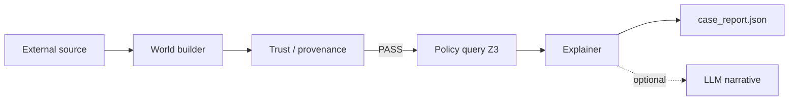

# Dev plan: External world / policy case pipeline v4 — World → Query → Explain → Trust

**Status:** Implemented (v4 default in `external_tester/run.py`)  
**Priority:** P0  
**Supersedes (product):** `dev_plan_external_world_tester_v1.md`, v2, v3 fill-orchestration plans  
**Prerequisite:** Pivot compile path (`meta_scheme.json`, `rules_extracted.json`, linearized assessment artifact)  
**Package:** `NagV/pivot_pipeline/external_tester/` (rename conceptually to **policy case pipeline**; package path may stay for import stability)

---

## 1. Vision (one paragraph)

Unstructured source → **partial world** (stated + unknown) → optional **provenance** on stated fields only → **Z3** decides **compatible | incompatible | unknown** → **explanation** from witness or unsat core (linearized rule lines) → optional LLM narrative. **No** fill-agent `golden.sat`, **no** completeness critic loop, **no** pass/fail = “LLM agreed with Z3.”

---

## 2. Four jobs (separate modules)

| Job | Module (proposed) | Decides |
|-----|-------------------|---------|
| **World** | `world_builder.py` | What is the case? Stated values + cites; unknown explicit |
| **Query** | `policy_query.py` | Compatible? **Z3 only** |
| **Explain** | `explainer.py` | Why? Unsat core / witness → `rule_id` + linearized lines |
| **Trust** | `trust.py` (wraps provenance review) | Are **stated** fields supported by cited lines? |

Orchestration: `run.py` — linear pipeline, bounded provenance refill only.



---

## 3. Design choices (defaults for v4)

| Question | v4 choice | Notes |
|----------|-----------|-------|
| Unknown variables | **CWA at query time only** (bool false, int 0) | Stated vs unknown vs **defaulted** in report; never silent false during extract |
| Primary user result | **`compatible` \| `incompatible` \| `unknown`** | No `golden.sat` match verdict |
| Derived fields | **Z3 witness** after pinning stated grounded facts | One generic engine; optional narrow LLM derive only for vars witness leaves unknown (P2) |
| Forbidden action | **Full-policy pathway SAT** (current compiler) | Explain via **unsat core**, not “approval” wording |
| Unknown blocks query? | **No** (default); env `PIVOT_CASE_UNKNOWN_POLICY=block` optional | `block` skips Z3 until stated or operator override |
| Legacy `decision_query` | **Debug flag only** | `--case-query-mode rule --case-query-rule R0001` |

---

## 4. World builder

### 4.1 Output schema: `PolicyCaseWorldV1`

```json
{
  "schema_version": "1",
  "instance_id": "ext_001",
  "stated": [
    {
      "variable": "years_in_support",
      "sort": "int",
      "status": "present",
      "value": 3,
      "provenance": { "line_numbers": [10], "quotes": ["..."] },
      "tier": "grounded"
    }
  ],
  "unknown": ["salary_expectation", "..."],
  "derived": [
    {
      "variable": "meets_minimum_tenure",
      "sort": "bool",
      "status": "derived",
      "value": true,
      "source": "z3_witness",
      "rationale": "witness after pinning stated grounded"
    }
  ],
  "coverage": {
    "stated_count": 66,
    "unknown_grounded_count": 20,
    "derived_count": 22,
    "total": 94
  }
}
```

- **`stated`:** only **grounded** tier; `present` | `inferred`; provenance required.
- **`unknown`:** grounded names with no defensible cite (no value in JSON row).
- **`derived`:** populated in derive step (not read from document in phase 1).

### 4.2 Phase 1 — Extract (keep from v3, simplify)

- Chunked batches (`fill_batches.py`, `variable_tiers.py`).
- Prompt: `external_world_extract_phase1.md` (rename from phase1).
- **Remove:** `external_world_fill_golden.md`, monolithic `external_world_fill.md` from default path.

### 4.3 Phase 2 — Derive (replace LLM-primary derive)

**Default: Z3 witness (generic)**

1. Build solver from `meta_scheme`.
2. Assert equalities for every **stated** grounded variable.
3. `check()`:
   - **unsat** → early `incompatible` candidate (grounded facts alone contradict policy); still run full query after CWA for report consistency, or short-circuit per env.
   - **sat** → `model()` → read all variables; split into `derived` (tier) vs remaining grounded not stated → move to `unknown` or default at query.
4. Store witness values in `derived` / `completed_world` artifact.

**Optional fallback (env `PIVOT_CASE_DERIVE_MODE=llm_glossary`):** current `run_phase2_derive` LLM + glossary for derived tier only.

### 4.4 Artifacts

| File | Content |
|------|---------|
| `policy_case_world_phase1.json` | Stated + unknown list |
| `policy_case_world.json` | Full world after derive |
| `policy_case_world_trace.jsonl` | Batch / derive events |

---

## 5. Policy query

### 5.1 Input

- `meta_scheme`
- `PolicyCaseWorldV1` → build `world: dict[str, int|bool]`:
  - stated + derived values fixed
  - `unknown` grounded → apply CWA per `world_defaults.py` at **query time**
  - record `defaulted_variables[]`

### 5.2 Output: `PolicyQueryResultV1`

```json
{
  "schema_version": "1",
  "z3_status": "sat",
  "compatibility": "compatible",
  "defaulted_variables": ["salary_expectation"],
  "default_policy": "cwa_pessimistic_v1"
}
```

| `z3_status` | `compatibility` |
|-------------|-----------------|
| `sat` | `compatible` |
| `unsat` | `incompatible` |
| `unknown` | `unknown` |

**No `golden`. No `diff_instance` pass/fail on sat match.**

### 5.3 Implementation

- Reuse `build_solver` + `execute_instance` scenario path internally, or thin wrapper in `policy_query.py`.
- `template_suite.diff` **not used** for external case reports.

---

## 6. Explainer

### 6.1 SAT (compatible)

- Persist **witness** (full model or delta from pinned facts).
- Optional: list **active constraints** — rules whose formula is non-vacuous under witness (P1 heuristic: CONSTANT_RELATIONAL + triggered implications).

### 6.2 UNSAT (incompatible)

- On `unsat`, compute **unsat core** (Z3):
  - Track `rule_id` ↔ formula assertions in `z3_compile` (new optional assertion labels) **or** map core boolean vars back to rules via `formulas_by_id`.
- Join to `linearized_model_for_assessment.txt` lines.
- Output `policy_case_explanation.json`:

```json
{
  "schema_version": "1",
  "compatibility": "incompatible",
  "unsat_core_rules": [
    { "rule_id": "R0036", "linearized": "R0036 | LOGICAL_IMPLICATION | IF ..." }
  ],
  "defaulted_variables": ["..."],
  "note": "28 variables assumed false/0 at query"
}
```

### 6.3 Optional LLM narrative (P3)

- Prompt: `external_world_explain_narrative.md`
- Input: explanation.json + stated cites only
- Output: `policy_case_narrative.txt`
- **Must not** change `compatibility`

---

## 7. Trust (provenance only)

- Keep blind cited-lines review (`review_agent.py` → `trust.py`).
- Review **only `stated`** assignments (not derived, not unknown).
- Max **2** provenance-driven refill rounds (`PIVOT_CASE_PROVENANCE_MAX_ROUNDS`).
- **Remove from default pipeline:** `completeness_critic.py`, link-consistency as **hard** gate.

Optional soft check: `link_consistency.py` logs warnings to trace, does not block.

---

## 8. Final report: `policy_case_report.json`

```json
{
  "schema_version": "1",
  "instance_id": "ext_001",
  "outcome": "complete",
  "provenance_verdict": "PASS",
  "compatibility": "incompatible",
  "z3_status": "unsat",
  "world_coverage": { "stated_count": 66, "unknown_grounded_count": 20, "defaulted_at_query": 20, "derived_count": 22, "total": 94 },
  "explanation_path": "policy_case_explanation.json",
  "narrative_path": null
}
```

**Success:** `outcome: complete` when provenance PASS and query ran (any compatibility).  
**Not:** `external_tester_ok` tied to golden match.

---

## 9. Cleanup — remove or demote (v1–v3 external tester)

### 9.1 Delete after v4 wired (or move to `external_tester/_legacy/`)

| Item | Reason |
|------|--------|
| `completeness_critic.py` | Replaced by Z3 + optional soft link warnings |
| `prompts/external_world_completeness_critic.md` | Same |
| `prompts/external_world_fill_golden.md` | No golden.sat |
| `prompts/external_world_fill.md` | Monolithic pre-v3 fill |
| `fill_agent.py` | Monolithic v2 path; remove after one release with `--legacy-fill` shim if needed |
| `run_fill_orchestration` golden step | Remove `run_golden_sat` |

### 9.2 Demote / simplify

| Item | Action |
|------|--------|
| `link_consistency.py` | `warn_only=True` default; no refill loop |
| `fill_orchestration.py` | Refactor into `world_builder.py`; delete file when done |
| `lower.py` | Rename `world_to_z3.py`; scenario-only |
| `external_tester_run_report.json` | Rename `policy_case_report.json`; keep alias write for 1 release |
| `execute_after_review` golden diff | Replace with `run_policy_case_pipeline` |
| Env `PIVOT_EXTERNAL_COMPLETENESS_*` | Remove |
| Env `PIVOT_EXTERNAL_TEST_MODE=decision_query` | Rename `PIVOT_CASE_QUERY_MODE`; debug only |

### 9.3 Keep

| Item |
|------|
| `source_numbering.py`, `variable_catalog.py`, `variable_tiers.py`, `fill_batches.py`, `rule_glossary.py` |
| `review_agent.py` / `review_pack.py` / `review_aggregate.py` |
| `world_defaults.py` (query-time CWA only) |
| `syntax_repair_agent.py`, `api_retry.py`, `llm.py`, `trace.py`, `schemas.py` (extended) |
| Chunked phase1/2 prompts (rename, trim phase2 if Z3 derive default) |

### 9.4 Docs / diagrams

- Replace `external_world_tester_overview.md` / `.mmd` with v4 four-job diagram.
- Update `pipeline_e2e_overview.md` stage ⑧ text.
- Add superseded banner to v1–v3 dev plans pointing here.

---

## 10. Code layout (target)

```
external_tester/
  __init__.py              # run_policy_case_pipeline
  run.py                   # CLI + orchestrator
  schemas.py               # PolicyCaseWorldV1, PolicyQueryResultV1, ExplanationV1, ReportV1
  world_builder.py         # extract + derive (Z3 witness)
  policy_query.py          # compatibility only
  explainer.py             # core + linearized
  trust.py                 # provenance wrapper
  world_to_z3.py           # was lower.py
  world_defaults.py        # query-time CWA
  variable_tiers.py
  fill_batches.py
  rule_glossary.py         # optional LLM derive
  source_numbering.py
  variable_catalog.py
  review_agent.py          # used by trust.py
  review_pack.py
  review_aggregate.py
  syntax_repair_agent.py
  api_retry.py
  llm.py
  trace.py
  link_consistency.py      # warn-only
  # REMOVED: completeness_critic.py, fill_agent.py (post-migration)
```

**Z3 changes (shared):**

- `z3_compile.py`: optional labeled assertions per `rule_id` for unsat core mapping (P1).

---

## 11. Implementation phases

### Phase A — Schemas + query + report (P0)

- [ ] `PolicyCaseWorldV1`, `PolicyQueryResultV1`, `PolicyCaseReportV1`
- [ ] `policy_query.py`: stated + derived + query-time CWA; emit `compatibility` only
- [ ] Remove `golden` from default fill path; stop calling `diff_instance` for case pipeline
- [ ] `policy_case_report.json` writer
- [ ] Tests: toy policy, stated-only world, compatible/incompatible

### Phase B — World builder refactor (P2)

- [ ] `world_builder.py` from `fill_orchestration` phase1
- [ ] Unknown list explicit (no `not_found` rows in stated)
- [ ] Z3 witness derive (default)
- [ ] Provenance max 2 refills, stated-only
- [ ] Delete golden fill prompt usage

### Phase C — Explainer (P1)

- [ ] Label assertions or core→rule mapping in `z3_compile`
- [ ] `explainer.py` + `policy_case_explanation.json`
- [ ] Wire linearized artifact from work_dir

### Phase D — Cleanup (required)

- [ ] Remove `completeness_critic.py` + prompt
- [ ] Remove or gate `fill_agent.py` behind `--legacy-external-fill`
- [ ] Remove monolithic fill prompt from default
- [ ] Simplify `run.py` loop (no completeness cycles)
- [ ] Update CLI flags: `--case-*` preferred; deprecate `--external-test-mode` alias
- [ ] Update README + diagrams
- [ ] Migrate tests in `test_external_tester.py`

### Phase E — Optional narrative (P3)

- [ ] `external_world_explain_narrative.md` + `explain_narrative.py`
- [ ] CLI `--with-case-narrative`

---

## 12. CLI (target)

```powershell
python -m pivot_pipeline.external_tester.run `
  --work-dir NagV\exports\pivot_runs\... `
  --external-source path\to\source.txt
```

Flags:

| Flag | Default |
|------|---------|
| `--case-unknown-policy` | `cwa` (`block` optional) |
| `--case-derive-mode` | `z3_witness` (`llm_glossary` optional) |
| `--with-case-narrative` | off |
| `--legacy-case-query` | off (decision_query debug) |

Env aliases: keep `PIVOT_EXTERNAL_*` one release, document `PIVOT_CASE_*`.

---

## 13. Success criteria

- [ ] Default run produces `policy_case_report.json` with `compatibility` from Z3 only
- [ ] No `golden.sat` in default artifacts
- [ ] Stated vs unknown vs defaulted-at-query visible in report
- [ ] UNSAT runs include `unsat_core_rules` with `rule_id` + linearized snippet
- [ ] Provenance reviews stated only; ≤2 refill rounds
- [ ] Completeness critic removed; no fill cycle 1–6 oscillation
- [ ] v3 monolithic golden/completeness paths deleted or legacy-flag only
- [ ] Tests pass; recruitment-scale run completes with explanation artifact

---

## 14. Migration note

- Old `external_world_fill.json` (with `golden.sat`) incompatible with v4 report schema.
- Re-run case pipeline after upgrade.
- `external_tester_run_report.json` deprecated alias optional one release.

---

## 15. Open items (post-v4)

- Pathway-scoped query (multiple NL paths, not single AND)
- Interactive unknown resolution UI
- Deterministic forward derive without Z3 witness for perf
- Sensitivity: “would compatible if unknown X were true?”

---

*End of plan.*
