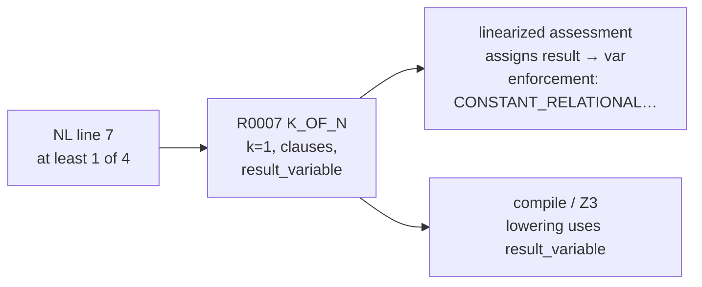

# Dev plan: K_OF_N Way B — in-place enforcement (no append companion rules)

**Status:** Implemented (Way B default in pivot_pipeline)  
**Priority:** P1  
**Problem:** Test-Repair, IR validation, and Pivot Tester disagree on how global `K_OF_N` obligations are enforced. Append-merge (R0010/R0011) stops the repair loop but Tester flags companions as “extra rules,” recreating friction.  
**Principle (Way B):** **One NL line → one `rule_id`.** Global “every applicant / at least k of n” stays a **`K_OF_N` block** with **`result_variable`**; enforcement is visible in the **assessment linearized** view, not as a second `CONSTANT_RELATIONAL` row. Compile/lowering already wires `result_variable` → `LOGICAL_IMPLICATION` for Z3.

**Related:** `dev_plan_k_of_n_and_assessment_views_v1.md` (assessment view — done); append-merge in `test_repair_rules_payload.py` (done — **to be gated off** for Test/Cross repair by this plan).

---

## 1. Vision (one paragraph)

Operators should get a **single coherent story**: extract may emit `K_OF_N`; Tester checks NL against the **expansion-preserving** linearized view; Test-Repair **only edits existing rule ids** by setting `result_variable` (and fixing clauses) when enforcement is missing; IR validation rejects **no-op** repairs (`yields` on `K_OF_N`, unchanged focus rules) but **does not require** appending companion `CONSTANT_RELATIONAL` rules; Tester **does not** treat valid `K_OF_N` + `result_variable` as incomplete nor flag non-existent “extra enforcement rules.” No endless REPAIR loop, no spurious R0010 warnings.

---

## 2. Problem / user story

| Symptom | Root cause |
|--------|------------|
| Repair adds `yields` on `K_OF_N` → “compiled” but unchanged | Sanitize strips illegal keys; old path skipped validation |
| Repair adds R0010/R0011 → merge OK → Tester says “remove extra rule” | Tester uses 1:1 NL↔rule_id; companions break that convention |
| Validation says “add companion with new rule_id” | Contradicts merge (was: no new ids) before append; after append, contradicts Tester |
| Resume fails after `PROCEED_INCOMPLETE` | Handoff clears `approved_finding_ids` (separate UX fix — keep clearer error) |

**Backend Engineer** is the reference run; the fix must apply to **any** policy with global `K_OF_N` + `CONSTANT_RELATIONAL` globals (R0006-style), not a one-off JSON edit.

---

## 3. Target semantics (Way B)



| Layer | Rule |
|-------|------|
| **Extract** | Prefer `K_OF_N` for k-of-n NL; for **GLOBAL** obligations include **`result_variable`** when NL is mandatory (“every applicant has…”). |
| **Assessment linearized** | Show `assigns result → <var>` and either `enforcement: CONSTANT_RELATIONAL yields SATISFIED on <var>` **or** explicit “satisfied via K_OF_N lowering at compile” (wording TBD in prompt). |
| **Tester** | **PASS** when `K_OF_N` has `result_variable` + clauses match NL; **do not** require a second rule id; **do not** flag non-existent companion as “extra.” |
| **Test-Repair** | Edit **focus `K_OF_N` only**; set/fix `result_variable` and clauses; **no new `rule_id`s**. |
| **IR validation** | Reject stripped `yields`/`variable` on `K_OF_N`; reject unchanged focus rules; **remove** “GLOBAL K_OF_N must have separate CONSTANT_RELATIONAL companion” check. |
| **Merge** | **Default `allow_append_rules=False`** for Test-Repair and Cross-Repair (code may retain append for explicit opt-in / future flag). |

**Explicit non-goals (v1):** Auto-delete R0010/R0011 from existing work dirs; changing DNF `K_OF_N` lowering; fixing R0001 header tautology (still triage ignore / separate extract prompt tweak).

---

## 4. Design choices

| Question | Choice | Notes |
|----------|--------|-------|
| Companion `CONSTANT_RELATIONAL` rows | **Not required** in `rules_extracted.json` | Enforcement at compile via `lower_k_of_n` when `result_variable` set |
| Append new rule ids | **Off by default** | `merge_repairer_output(allow_append_rules=False)`; keep helper for `PIVOT_REPAIR_ALLOW_APPEND_RULES=1` if ever needed |
| Tester vs compile | **Tester uses assessment view only** | Already D2 in k_of_n assessment plan |
| “Enforcement” in linearized | **Show compile-time note** | e.g. “enforcement: via lowering when result_variable set” so Tester stops asking for R0010 |
| Extract teaching | **vNext addendum + examples** | Minimal `K_OF_N` example includes `result_variable` for GLOBAL mandatory NL |
| Cross-Repair | **Same rules as Test-Repair** | Same merge default + prompts addendum |
| PROCEED_INCOMPLETE handoff | **Keep**; clearer error if resume with empty approvals | Done in `tester_repair_resume.py` |

---

## 5. Implementation steps

### Step 1 — IR validation (repair path)

**File:** `pivot_pipeline/repair_ir_validation.py`

- **Remove** (or gate behind env `PIVOT_K_OF_N_REQUIRE_COMPANION=1`) the loop that raises when GLOBAL `K_OF_N` has `result_variable` but no `CONSTANT_RELATIONAL` companion.
- **Keep** no-op detection, dropped `yields`/`variable` on `K_OF_N`, unchanged focus rule checks.
- **Update** `compile_validation_hint()` — remove “append companion” text; point to `result_variable` on focus `K_OF_N`.

**Tests:** Update `test_validate_global_k_of_n_requires_enforcement_companion` → expect **pass** with only `result_variable`; add test that companion is **optional** when present.

---

### Step 2 — Merge: default no append

**File:** `pivot_pipeline/test_repair_rules_payload.py`

- Change default `allow_append_rules: bool = False`.
- Env override: `PIVOT_REPAIR_ALLOW_APPEND_RULES=1` → `True` (document in README).
- **Keep** `suggest_next_rule_ids()` for opt-in append mode only (do not send in payload when append off).

**Files:** `tester_repairer_agent.py`, `cross_repairer_agent.py`

- Stop sending `allow_append_rules` / `suggested_next_rule_ids` in payload when append disabled (or send `allow_append_rules: false` explicitly).

**Tests:** Existing `test_merge_appends_companion_*` runs with `allow_append_rules=True`; add test default rejects R0010.

---

### Step 3 — Assessment linearized (Tester readability)

**File:** `pivot_pipeline/repair_ir_validation.py` — `k_of_n_binding_note()`

- When `result_variable` set and **no** separate `CONSTANT_RELATIONAL` on that var:
  - Emit: `enforcement: via compile lowering (result_variable → required atom EQ true)`  
  - **Not** `no enforcement on <var> — add companion…` (current text drives false Tester findings).

**File:** `pivot_pipeline/assessment_linearize.py` — already passes `all_rules`; verify line appears in `linearized_model_for_assessment.txt`.

**Tests:** `test_assessment_linearize_k_of_n_result_variable` expects new enforcement line, not “no enforcement”.

---

### Step 4 — Pivot Tester prompts

**File:** `pivot_pipeline/prompts/tester_pivot_semantic.md`

Add section **Global K_OF_N (Way B)**:

- Compared artifact remains assessment linearized (expansion).
- For `[Rxxxx] K_OF_N` with `assigns result → <var>` and enforcement-via-lowering note: treat as **fully enforced** for mandatory global NL (“every applicant…”).
- **Do not** flag `result_variable` alone as `template_mismatch`.
- **Do not** flag non-existent companion rules; **do not** recommend adding R0010-style rows.
- **Do** flag missing `result_variable` or wrong k/clauses vs NL.
- **Ordering:** One NL line maps to the `K_OF_N` rule id (e.g. R0007 = line 7); ignore lowered-only duplicate ids if not in assessment file.

**Optional:** `tester_json_repair.md` — same bullets if JSON repair paraphrases findings.

**Tests:** Fixture policy: NL + rules with `K_OF_N` + `result_variable` only → mock tester or golden finding list “ok” (lightweight prompt regression optional).

---

### Step 5 — Test-Repairer / Cross-Repairer prompts

**Files:**

- `prompts/test_repairer.md`
- `prompts/test_repairer_ir_addendum.md`
- `prompts/cross_repairer_ir_addendum.md` (K_OF_N section — align with Way B)

Changes:

- Remove / contradict “append new rule from `suggested_next_rule_ids`” as default fix.
- **Mandatory fix for GLOBAL K_OF_N enforcement finding:** set `result_variable` on the **cited `K_OF_N` rule**; fix `k` / `clauses` to match NL; **never** top-level `yields` on `K_OF_N`.
- **Alternative allowed:** replace `K_OF_N` with `LOGICAL_IMPLICATION` + `or` on **same `rule_id`** only if NL is conditional; global “every applicant” stays `K_OF_N`.
- Output must include **all existing** rule ids (stubs); **no new** rule ids unless `PIVOT_REPAIR_ALLOW_APPEND_RULES=1`.

**File:** `repairer_piv_agent.py` — `_compile_error_prompt_suffix` / `merge_error_prompt_suffix`: align with no-append default.

---

### Step 6 — Extract (upstream, reduces repair churn)

**Files:**

- `prompts/extractor_vnext_addendum.md`
- `prompts/vnext_template_examples.md`

Add minimal GLOBAL mandatory example:

```json
{
  "rule_id": "R0007",
  "template_class": "K_OF_N",
  "applies_to": "GLOBAL",
  "k": 1,
  "result_variable": "meets_example_requirement",
  "clauses": [ ... ]
}
```

Note: **Do not** add a separate `CONSTANT_RELATIONAL` rule for the same NL line in extract (Way B).

**Tests:** Optional integration test on small NL fixture (extract mock or golden `rules_extracted`).

---

### Step 7 — Documentation

| Doc | Update |
|-----|--------|
| `pivot_pipeline/README.md` | Way B: 1 NL = 1 rule; `K_OF_N` + `result_variable`; `PIVOT_REPAIR_ALLOW_APPEND_RULES` |
| `PIVOT_TEMPLATE_SYSTEM.md` | § enforcement: in-place vs companion (Way B default) |
| `ARCHITECTURE.md` | Tester/repair/validation alignment diagram |
| `diagrams/pipeline_e2e_overview.md` | One-line note under Tester |

---

### Step 8 — Verification (Backend Engineer work dir)

1. Re-run extract **or** hand-fix R0007/R0008: add `result_variable`; **delete** R0010/R0011 if present.
2. Run tester-only resume (no append):

```powershell
python -m pivot_pipeline `
  --input NagV\pivot_pipeline\inputs\Backend_Engineer.md `
  --work-dir NagV\exports\pivot_runs\Backend_Engineer_v1_wfm `
  --skip-phase0 `
  --rules-json NagV\exports\pivot_runs\Backend_Engineer_v1_wfm\rules_extracted.json `
  --interactive-policy `
  --with-tester `
  --with-test-repair
```

3. Triage: ignore T001; approve T002/T003 only if still about missing `result_variable`; **ignore** “remove R0010” class findings after Way B prompts.
4. **REPAIR** once → expect `result_variable` on R0007/R0008, **no** new ids, Tester **ok** or only header issue.
5. Continue critic/cross without `PROCEED_INCOMPLETE` unless header still blocked.

---

## 6. Test plan (pytest)

| ID | Test | Assert |
|----|------|--------|
| T1 | `test_merge_default_disallows_append` | Extra R0010 → `MergeRepairerOutputError` |
| T2 | `test_precompile_k_of_n_result_variable_only` | No companion; validation passes |
| T3 | `test_k_of_n_binding_note_enforcement_via_lowering` | Linearized text does not say “no enforcement” when `result_variable` set |
| T4 | `test_repair_ir_validation` regressions | Stripped yields still fails |
| T5 | `test_tester_interactive_loop` + mock repair | In-place patch only; no append |
| T6 | Optional golden | `tester_pivot_semantic.md` contains Way B bullets (grep test) |

---

## 7. Rollout / migration

| Item | Action |
|------|--------|
| Existing runs with R0010/R0011 | Manual delete or one-off repair “remove appended companions” (out of scope for auto-migration v1) |
| `PIVOT_REPAIR_ALLOW_APPEND_RULES` | Default unset = no append; document for experiments |
| Append-merge code | **Keep** in repo; not default path |
| Resume handoff | Users who used `PROCEED_INCOMPLETE` must re-triage or restored handoff |

---

## 8. Success criteria

- [ ] GLOBAL `K_OF_N` + `result_variable` passes Tester **without** companion rules in JSON.
- [ ] Test-Repair succeeds in **one** REPAIR session (typical) by setting `result_variable` only.
- [ ] No `unknown rule_id` / no append loop on Backend Engineer fixture.
- [ ] Linearized assessment does not show “no enforcement” when `result_variable` is set.
- [ ] Cross-Repair and Test-Repair share same defaults and K_OF_N prompt language.
- [ ] `pytest` pivot_pipeline tests green for T1–T5.

---

## 9. Task checklist (implementation order)

| Phase | Tasks |
|-------|--------|
| **P0** | Step 1 validation + Step 2 merge default + tests T1–T2 |
| **P1** | Step 3 linearized note + Step 4–5 prompts |
| **P2** | Step 6 extract examples + Step 7 docs |
| **P3** | Step 8 Backend Engineer verification + critic/cross continuation |

**Estimated touch:** ~8–12 files, ~200–350 LOC, mostly prompts + tests; small logic changes in `repair_ir_validation.py` and merge default.

---

## 10. Open questions (resolve during impl)

1. **Wording** for linearized “enforcement via lowering” line — must be unambiguous to Tester LLM (no “add R0010”).
2. Whether **Cross-Repair** keeps append env for recruitment policies that already use companion + gatekeeper pattern (if yes, only when `PIVOT_REPAIR_ALLOW_APPEND_RULES=1` and cross handoff cites gatekeeper booleans).
3. Auto-strip appended companions on repair success (nice-to-have; defer v1).

---

*End of plan.*
