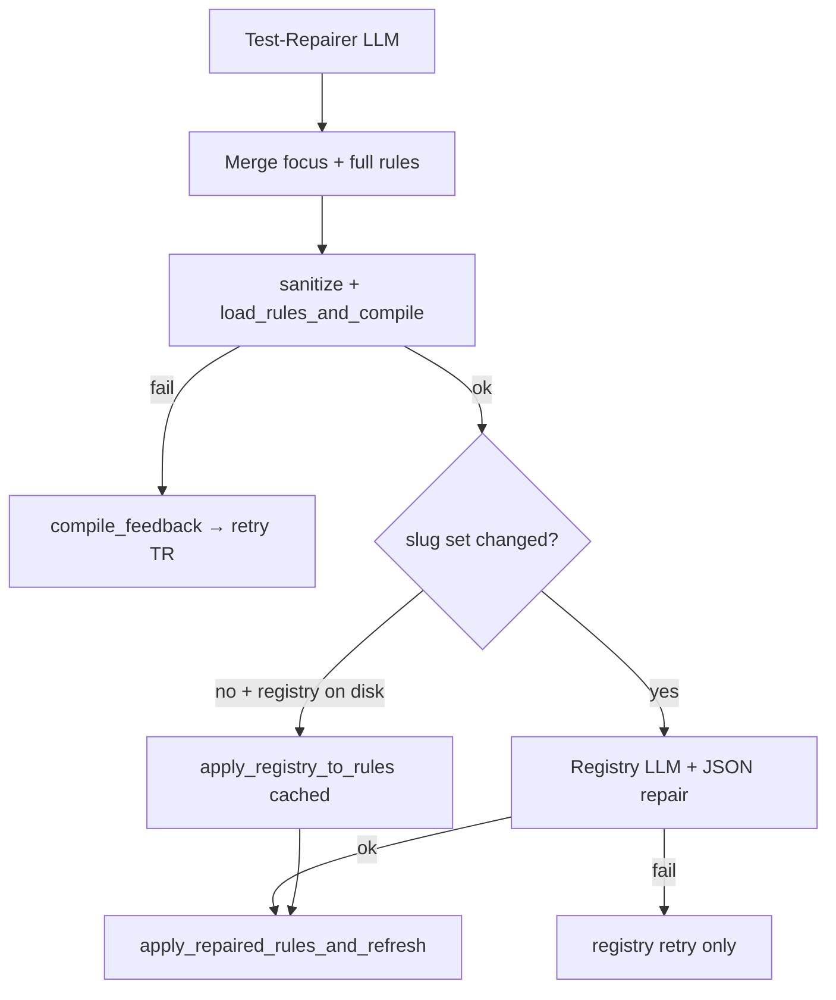

# Dev plan: Pivot Test-Repairer hardening — prompt, payload, registry, error routing

**Status:** Implemented  
**Priority:** P1 (recruitment `blocked_test_repair_compile` — registry JSON + thin prompt + mislabeled feedback)  
**Related run:** `NagV/exports/pivot_runs/recruitment_16_temp_wfm` — `test_repairer_trace.jsonl`, `tester_repair_handoff.json`  
**Prerequisite (done):** `dev_plan_pivot_tester_repair_resume_v1.md` (resume / re-REPAIR at compile budget)  
**Follow-up (optional):** `dev_plan_repairer_ir_constraints_json_retry.md` (already done for Repairer_Piv; extend patterns here)

---

## 1. Problem (simple terms)

After Pivot Tester approves findings (e.g. T001–T004), **Test-Repairer** should patch IR so rules align with processed NL + assessment linearized view, then **compile** and refresh artifacts.

**What went wrong in recruitment (representative):**

| Attempt | User-visible message | Actual failure stage |
|---------|----------------------|----------------------|
| 1–3 | `Registry after test repair failed` … `Unterminated string` | **Registry LLM** JSON parse — repairer may have succeeded |
| 4 | `Test-Repairer failed: 503 UNAVAILABLE` | **API** — not IR |
| Budget | `blocked_test_repair_compile` | **5 “compile attempts”** burned on registry/API, not always Pydantic |

**Structural gaps:**

1. **`test_repairer.md`** is ~45 lines; **Repairer_Piv semantic** has denylist, per-template allowlists, vNext/temporal appendices — but Test-Repairer does not.
2. **Feedback channel:** registry parse errors are passed as `compile_validation_error` + `_compile_error_prompt_suffix` (“see denylist”) — repairer is told to fix **rules** when **registry output** was broken.
3. **Registry:** single LLM call, `parse_json_object` only — no JSON repair loop (unlike Tester / Extract).
4. **Payload:** full **37-rule** array every attempt (~17k+ chars) with no **focus** on `rule_id`s from approved findings.
5. **Order of validation:** registry runs **before** local `sanitize_rules_jsonable` + `load_rules_and_compile` — so invalid IR from repairer may never get a clear Pydantic message before registry noise.
6. **Retry budget:** registry/API failures consume the same counter as true compile failures (`PIVOT_TESTER_REPAIR_COMPILE_ATTEMPTS`).

**Goal:** Make Test-Repairer **generally** able to produce valid IR for tester-class findings (SET_INCLUSION ↔ implication, atom vs `yields`, wrong variables), and make the **control loop** honest about failure stage so retries help.

---

## 2. Approved scope (six features + one optional)

### F1 — Align Test-Repairer prompt with semantic repairer IR cookbook ✅

**Problem:** Repairer invents illegal shapes (`IN` inside `atom`, `"SATISFIED"` in `required_condition`, stray `action` on non-PREEMPTION) because `test_repairer.md` lacks normative ConditionExpr / template guidance.

**Change:**

| Approach | Detail |
|----------|--------|
| **Preferred** | New shared include `prompts/repairer_ir_normative.md` (extracted from `repairer_piv_semantic.md`: denylist, allowlists, v1 shape, minimal JSON examples) — appended by **both** semantic repairer and test repairer to avoid drift. |
| **Test-specific addendum** | New subsection in `test_repairer.md` or `test_repairer_ir_addendum.md`: **ConditionExpr in `LOGICAL_IMPLICATION`** |

**Normative bullets to add (tester-relevant):**

- **`atom`:** `operator` is **`EQ` / `NEQ` / `GT` / `LT` / `GTE` / `LTE` only** — never `IN` / `NOT_IN`. List membership belongs on **`SET_INCLUSION`** (`constant_array` + `inclusion_operator`).
- **`required_condition` / `trigger_condition`:** boolean flags use **`value: true` or `false`** — not `"SATISFIED"` / `"UNSATISFIED"` (those are rule-level **`yields`** on relational templates only).
- **SET_INCLUSION → flag implication (tester pattern):** When a finding asks to replace or supplement SET_INCLUSION with an implication, use **`LOGICAL_IMPLICATION`**: `trigger_condition` = `or` of `atom` equalities (one per platform/category boolean), `required_condition` = `atom` on the flag variable `EQ true`. Do **not** encode list membership inside an `atom`.
- **Reuse** denylist + allowlists + PREEMPTION single-target rules from semantic repairer.
- **Append** vNext examples + temporal addendum to test repairer the same way as `repairer_piv_agent._vnext_repairer_appendix()` (shared helper).

**Acceptance:** Prompt text references denylist; manual review shows SET_INCLUSION / atom rules present; recruitment-class patches are encodable without reading semantic repairer source.

---

### F2 — Focused rules payload (stubs for unchanged rules) ✅

**Problem:** Full rules JSON dominates the prompt; model attention dilutes on large policies.

**Design:**

1. Derive `focus_rule_ids: list[str]` from `handoff.findings` (`rule_id` on each finding; optional `related_rule_ids` if present in report schema).
2. Build LLM payload `rules` as:
   - **Full rule dict** for each id in `focus_rule_ids`
   - **Stub** for all other rules: `{ "rule_id", "template_class", "applies_to", "_payload_stub": true }` only (no condition trees).
3. Prompt instruction: **Output a complete `rules` array** — for stub ids, **copy verbatim** from input (same `rule_id`, `template_class`, and all fields you did not receive in stub must be preserved by echoing the stub unchanged OR by returning the full rule unchanged). **Only edit** `focus_rule_ids`.
4. **Server-side merge** in `tester_repairer_agent.py` (or `tester_interactive_loop.py`):

```python
merged = merge_repairer_output(full_rules=rules, repairer_rules=out.rules, focus_ids=focus_ids)
```

- If repairer returns a stub unchanged → keep `full_rules` entry.
- If repairer returns expanded rule for a focus id → use repairer version.
- If repairer omits a rule_id → error / retry with explicit “missing rule_id R00xx”.
- Validate: `len(merged) == len(full_rules)` and ids match.

**Payload fields:**

```json
{
  "focus_rule_ids": ["R0006", "R0009", "R0013", "R0017"],
  "rules": [ /* full or stub */ ]
}
```

**Acceptance:** Unit test — 10 rules, focus 2 → prompt JSON size drops; merge restores 10 rules; non-focus bytes identical to input.

---

### F3 — Error stage routing (registry vs compile vs API) ✅

**Problem:** One `compile_feedback` string and `_compile_error_prompt_suffix` for all failures.

**Design:**

Introduce `RepairAttemptError` or structured trace fields:

| `error_stage` | User message prefix | Fed back to repairer? | Suffix |
|---------------|---------------------|----------------------|--------|
| `repairer_json` | `Test-Repairer output parse failed` | Yes (JSON recovery — existing) | `_json_recovery_suffix` |
| `repairer_api` | `Test-Repairer failed (API)` | Optional short note only; **do not** burn full compile suffix | — |
| `registry_json` | `Registry pass failed (invalid JSON)` | **No** — retry registry only, not repairer | — |
| `registry_api` | `Registry pass failed (API)` | No | — |
| `rules_compile` | `Test-repaired rules did not compile` | Yes | `_compile_error_prompt_suffix` |
| `rules_merge` | `Test-Repairer returned incomplete rules` | Yes (merge-specific) | new `_merge_error_suffix` |

**Handoff / trace:**

```json
{
  "last_repair_error_stage": "registry_json",
  "last_compile_validation_error": "..." 
}
```

- Keep `last_compile_validation_error` for **rules_compile** only (backward compatible for resume).
- Add `last_registry_error` on handoff when stage is registry (resume can retry registry without re-running repairer — see F4).

**Loop change (`tester_interactive_loop.py`):**

- On `registry_json` / `registry_api`: **do not** set `compile_feedback` from registry text; increment **registry attempt** sub-counter or call `run_registry_pass_with_repairs` (F4) without consuming repairer attempt.
- On `rules_compile`: set `compile_feedback` as today.
- On `repairer_api` (503): optional **do not** increment compile attempt if env `PIVOT_TEST_REPAIR_COUNT_API_AS_ATTEMPT=0` (default **0**).

**Acceptance:** Mock registry `ValueError` → repairer called once, registry retried; trace shows `error_stage: registry_json`. Mock Pydantic compile fail → `compile_feedback` includes validation text.

---

### F4 — Registry JSON repair + skip when slugs unchanged ✅

**P4a — Registry JSON repair (mirror tester/extract)**

New `run_registry_pass_with_repairs()` in `registry_pass.py`:

- Loop: LLM → `parse_json_object` → on fail, repair prompt `prompts/registry_json_repair.md` (placeholders: `parse_error`, `failed_output_snippet`, `used_slugs`, `numbered_lines_excerpt`).
- Env: **`PIVOT_REGISTRY_JSON_REPAIR_MAX`** (default **3**, clamp 0–10).
- Trace: append to `registry_pass_trace.jsonl` in `work_dir` when called from test-repair path.

Wire in `tester_interactive_loop.py` (and optionally `semantic_critic_loop.py`, `run.py` post-repair) via `registry_pass_from_nl_and_rules_with_repairs`.

**P4b — Skip registry LLM when variable slug set unchanged**

After Test-Repairer returns `new_rules`:

```python
before = set(collect_used_slugs(rules))
after = set(collect_used_slugs(new_rules))
```

If `before == after` and `work_dir / "identifier_registry.json"` exists:

- Skip `run_registry_pass*`; apply existing registry with `apply_registry_to_rules(new_rules, build_alias_map(existing_reg))`.
- Log: `[policy gate] Registry skipped (slug set unchanged); reusing identifier_registry.json`.

Env override: **`PIVOT_TEST_REPAIR_SKIP_REGISTRY=1`** forces skip always (dev/debug); document in `.env.example`.

**Acceptance:** Unit test — same slugs, mock registry LLM never called. Unit test — invalid registry JSON fixed on repair attempt 2.

---

### F5 — Pre-compile validation before registry ✅

**Problem:** Registry runs on possibly invalid IR; repairer never sees Pydantic errors if registry fails first.

**Change in `tester_interactive_loop.py` after `out.rules` merge (F2):

```python
from pivot_pipeline.ir import sanitize_rules_jsonable, load_rules_and_compile

sanitized = sanitize_rules_jsonable(merged)
try:
    load_rules_and_compile(sanitized, policy_id=...)  # or existing helper
except Exception as ce:
    # error_stage rules_compile; compile_feedback = str(ce); continue loop
else:
    new_rules = sanitized  # then registry pass
```

- Do **not** write `rules_after_test_repair.json` until compile succeeds (unchanged intent).
- Optional: log dropped keys from sanitize (debug) to `test_repairer_trace.jsonl` as `sanitize_dropped_keys`.

**Acceptance:** Repairer returns rule with top-level `action` on LOGICAL_IMPLICATION → sanitize strips → compile succeeds without repairer retry (when semantics OK).

---

### F6 — Attempt budget accounting (optional but recommended in v1) ✅

**Problem:** Five “compile attempts” include registry noise and 503.

**Design (minimal):**

| Counter | Env | Default | Counts |
|---------|-----|---------|--------|
| Repairer+compile | `PIVOT_TESTER_REPAIR_COMPILE_ATTEMPTS` | 5 | `run_test_repairer` + merge + **rules_compile** failures |
| Registry | `PIVOT_TESTER_REPAIR_REGISTRY_ATTEMPTS` | 3 | Registry parse/API/repair loop **per repairer success** |
| REPAIR sessions | `PIVOT_TESTER_REPAIR_MAX_ROUNDS` | 3 | Unchanged |

Inner loop pseudocode:

```
for compile_attempt in range(COMPILE_CAP):
    out = run_test_repairer(...)
    merged = merge(...)
    try: pre_compile(merged)
    except: compile_feedback = ...; continue  # counts as compile_attempt

    for reg_attempt in range(REGISTRY_CAP):
        try: registry_with_repairs(...)
        except registry: continue reg_attempt  # does NOT increment compile_attempt
        break
    else: last_error = registry exhausted; break

    apply_repaired_rules_and_refresh(...)
    success
```

**Acceptance:** Test — 3 registry failures then success on reg attempt 4 does **not** increment `compile_attempt`; repairer invoked once.

---

### F7 — API 503 backoff (optional P2, non-blocking for v1) ⏸

- Env `PIVOT_LLM_RETRY_ON_503` + max waits in `pivot_llm_complete` or test-repair wrapper only.
- Document as follow-up if v1 ships without it.

---

## 3. Non-goals

- Changing Pivot Tester findings schema or triage UX.
- Merging Test-Repairer into Repairer_Piv (separate modes stay).
- Auto-fixing registry variable renames when slugs **do** change (still run full registry).
- IR schema extensions (e.g. multi-target PREEMPTION).
- Bumping `PIVOT_TESTER_REPAIR_MAX_ROUNDS` default.

---

## 4. Design diagrams

### 4.1 Test-repair attempt flow (after F3–F6)



### 4.2 Prompt composition (F1)

```text
test_repairer.md
  + repairer_ir_normative.md   (shared)
  + vNext appendix             (shared helper)
  + temporal_surrogates_addendum
  + test_repairer_ir_addendum.md (ConditionExpr / SET_INCLUSION patterns)
```

---

## 5. Implementation tasks

| ID | Task | Files |
|----|------|-------|
| P0.1 | F1: Extract `repairer_ir_normative.md`; wire into `repairer_piv_semantic.md` (include or duplicate-minimal) | `prompts/` |
| P0.2 | F1: `test_repairer_ir_addendum.md` + `_test_repairer_system_prompt()` helper | `tester_repairer_agent.py`, `prompts/` |
| P0.3 | F1: Shared `_vnext_repairer_appendix()` export from `repairer_piv_agent.py` for test repairer | `repairer_piv_agent.py`, `tester_repairer_agent.py` |
| P1.1 | F2: `focus_rule_ids_from_handoff()`, `build_rules_payload_stubs()`, `merge_repairer_output()` | `tester_repairer_agent.py` (new `test_repair_rules_payload.py` if preferred) |
| P1.2 | F2: Tests for merge + stub payload size | `tests/test_test_repair_rules_payload.py` |
| P2.1 | F3: `error_stage` in trace + handoff fields; split user messages | `tester_interactive_loop.py`, `tester_repair_resume.py` |
| P2.2 | F3: Stage-specific suffixes; stop feeding registry errors as compile_feedback | `repairer_piv_agent.py` or `tester_repairer_agent.py` |
| P3.1 | F4a: `registry_json_repair.md` + `run_registry_pass_with_repairs()` | `registry_pass.py`, `prompts/` |
| P3.2 | F4b: Slug-unchanged skip + `PIVOT_TEST_REPAIR_SKIP_REGISTRY` | `tester_interactive_loop.py`, `cli.py`, `run_test_repair.py` |
| P4.1 | F5: Pre-compile gate before registry | `tester_interactive_loop.py` |
| P4.2 | F6: Separate registry attempt counter + loop restructure | `tester_interactive_loop.py`, `tester_repairer_agent.py` |
| P5.1 | Tests: registry fail doesn’t call repairer twice; compile fail does; skip registry | `tests/test_tester_interactive_loop.py`, `tests/test_registry_pass.py` |
| P5.2 | Docs: ARCHITECTURE Step 5b, README env table, `run_test_repair --help` | `ARCHITECTURE.md`, `README.md`, `.env.example` |

---

## 6. Env / CLI summary (new)

| Variable | Default | Meaning |
|----------|---------|---------|
| `PIVOT_REGISTRY_JSON_REPAIR_MAX` | 3 | Registry output JSON repair attempts |
| `PIVOT_TESTER_REPAIR_REGISTRY_ATTEMPTS` | 3 | Registry pass tries per successful repairer output |
| `PIVOT_TEST_REPAIR_SKIP_REGISTRY` | 0 | Force skip registry LLM (dev) |
| `PIVOT_TEST_REPAIR_COUNT_API_AS_ATTEMPT` | 0 | If 0, 503 on repairer does not consume compile attempt |
| `PIVOT_TESTER_REPAIR_COMPILE_ATTEMPTS` | 5 | Unchanged — repairer + **rules_compile** only after F6 |

CLI: expose `--skip-registry` on `pivot-test-repair` / `run_tester` (already exists on pipeline) — document interaction with slug skip.

---

## 7. Test plan

1. **Unit:** `merge_repairer_output` — 5 rules, edit 1, stubs for 4 → identical non-focus rules.
2. **Unit:** `build_rules_payload_stubs` — focus 2 of 20 → serialized `rules` smaller than full dump.
3. **Unit:** Registry mock throws `ValueError` twice then succeeds — repairer LLM call count == 1; `error_stage` in trace.
4. **Unit:** `load_rules_and_compile` fails on bad atom — `compile_feedback` set; repairer called again; registry not called.
5. **Unit:** `collect_used_slugs` equal before/after — registry LLM not called; rules remapped via cached registry.
6. **Unit:** Handoff resume loads `last_compile_validation_error` only when stage was `rules_compile`.
7. **Manual:** Recruitment work_dir `--resume-tester-repair` after plan — T003-style patch compiles or gives clear Pydantic message (not registry unterminated string loop).

---

## 8. Risks

| Risk | Mitigation |
|------|------------|
| Repairer drops stub rules / returns partial array | Merge validator + `rules_merge` error stage with explicit missing ids |
| Stub payload confuses model | Prompt + test with golden “echo stub unchanged” |
| Shared `repairer_ir_normative.md` drift from semantic file | Single source; semantic prompt includes file by reference |
| Skip registry when slugs equal but **renames** in rule bodies needed | Only skip when slug **set** equal; if unequal, full registry |
| Token cost of registry repair | Cap `PIVOT_REGISTRY_JSON_REPAIR_MAX`; slug skip avoids call |
| F6 loop complexity | Keep tests table-driven per stage |

---

## 9. Rollout order

1. **F1 prompts** (low risk, immediate IR quality).
2. **F5 pre-compile** + **F3 error labels** (honest feedback).
3. **F2 payload stubs + merge** (size + focus).
4. **F4 registry repair + skip**.
5. **F6 budget split** + docs/tests.
6. **F7** optional later.

---

## 10. CLI examples (after implementation)

**Resume repair (unchanged entry):**

```powershell
.\.venv\Scripts\python.exe -m pivot_pipeline.run_test_repair `
  --work-dir NagV\exports\pivot_runs\recruitment_16_temp_wfm `
  --input NagV\exports\scope_rewriter\recruitment_16_temp_run\scope_rewriter\latest.nl `
  --interactive-tester
```

**Dev: skip registry LLM:**

```powershell
$env:PIVOT_TEST_REPAIR_SKIP_REGISTRY = "1"
.\.venv\Scripts\python.exe -m pivot_pipeline.run_test_repair ...
```

---

## 11. Summary

| Feature | One line |
|---------|----------|
| **F1** | Test-Repairer gets same IR cookbook as semantic repairer + ConditionExpr / SET_INCLUSION patterns |
| **F2** | Stubs for non-focus rules + server merge → smaller prompt, stable full policy |
| **F3** | Registry vs compile vs API errors labeled; only compile errors feed repairer |
| **F4** | Registry JSON repair loop + skip registry when slugs unchanged |
| **F5** | `sanitize` + `load_rules_and_compile` before registry |
| **F6** | Separate registry attempt budget from repairer/compile budget |
| **F7** | 503 backoff (optional follow-up) |

**Expected outcome:** Recruitment-class runs fail less often on **registry JSON noise**; when IR is wrong, repairer gets **actionable Pydantic feedback** and **normative encoding** for SET_INCLUSION / atom / `yields` mistakes.
