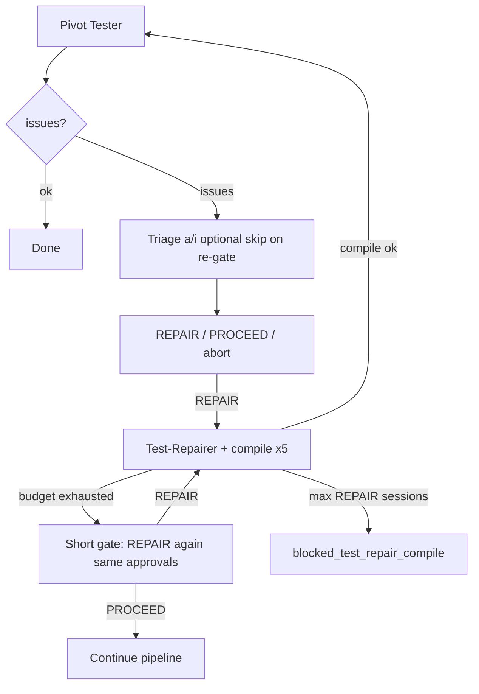
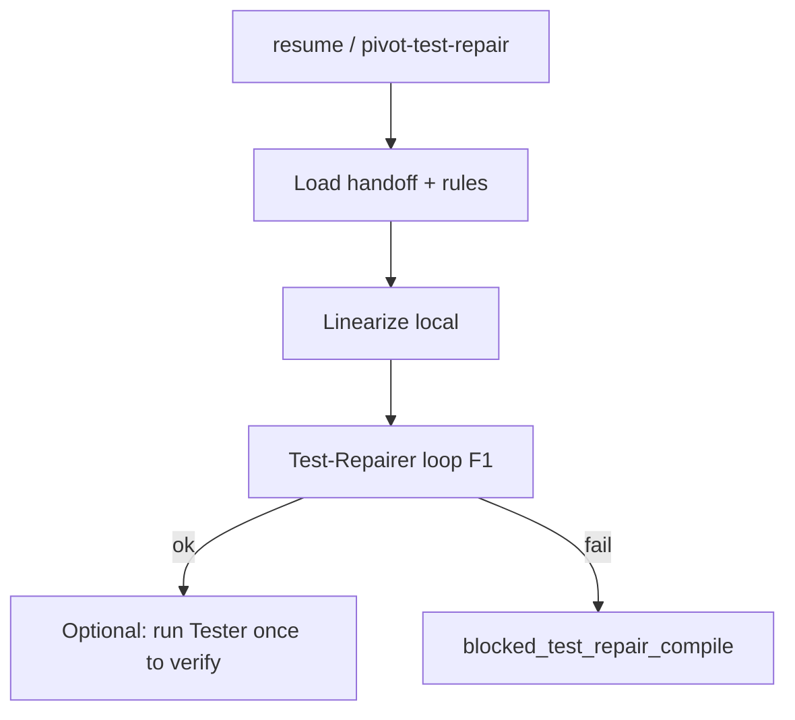

# Dev plan: Pivot Tester repair — resume, re-REPAIR at budget, compile retry budget

**Status:** Implemented  
**Priority:** P1 (recruitment run wasted Tester LLM on `blocked_test_repair_compile` retry)  
**Related run:** `NagV/exports/pivot_runs/recruitment_16_temp_wfm` — `tester_repair_handoff.json`, `test_repairer_trace.jsonl`  
**Prerequisite (done):** `PIVOT_TESTER_REPAIR_COMPILE_ATTEMPTS` default **5** per one `REPAIR` (`tester_repairer_agent.py`)

---

## 1. Problem (simple terms)

After Pivot Tester reports `issues`, the operator triages findings and types **`REPAIR`**. Test-Repairer patches IR and the pipeline tries to **compile** (up to **5** LLM attempts per `REPAIR`, with `compile_validation_error` fed back).

**Pain today:**

| Situation | What happens | Waste |
|-----------|----------------|-------|
| Compile budget exhausted (e.g. bad R0013 patch, then 503) | Process often **exits** with `blocked_test_repair_compile` | Next CLI run **re-runs Pivot Tester** (big LLM call) even though `tester_report.json` + approvals are on disk |
| Same session, budget exhausted | Inner loop `continue`s but **re-runs full triage** (`a`/`i` on every finding again) | Operator time; feels like starting over |
| 503 mid-repair | Compile attempts burn; little persistence of last error across **new** runs | Retry from scratch |

**Goal:** Treat **tester report + approved handoff** as a **checkpoint**. Retry **Test-Repairer only** until compile succeeds or the operator waives — without re-paying for Tester or re-triaging unless they choose to.

---

## 2. Approved scope (four features)

### F1 — Re-REPAIR at end of compile budget (same session) ✅ approved

When all **`PIVOT_TESTER_REPAIR_COMPILE_ATTEMPTS`** (default **5**) fail in one `REPAIR` session:

- **Do not** treat as terminal unless **`PIVOT_TESTER_REPAIR_MAX_ROUNDS`** (REPAIR sessions) is also exhausted.
- Return to a **short policy gate** (not full exit):
  - Message: compile budget exhausted; **same approved findings** still active; type **`REPAIR`** to run Test-Repairer again (**no new Pivot Tester call**).
  - **`PROCEED_INCOMPLETE`** / Enter abort unchanged.
- **Skip full triage** on this path when `approved_finding_ids` unchanged since last handoff write (operator already approved). Optional: `r` = re-triage if they want to change approvals.
- Persist **`last_compile_validation_error`** on handoff (or read tail of `test_repairer_trace.jsonl`) so the next `REPAIR` in the same run starts with feedback.

**Acceptance:** After 5 failed compile attempts, user sees gate again without re-running Tester; typing `REPAIR` runs Test-Repairer only (attempt counter resets to 1..5 for that new repair session).

### F2 — `--resume-tester-repair` (new run) ✅ approved

CLI flag on `pivot-pipeline` and `pivot_pipeline.run_tester`:

```powershell
python -m pivot_pipeline.run_tester `
  --work-dir ... `
  --input ...\latest.nl `
  --with-test-repair `
  --interactive-tester `
  --resume-tester-repair
```

**Requires on disk:**

- `tester_report.json` (`verdict: issues`)
- `tester_repair_handoff.json` with **non-empty** `approved_finding_ids`

**Behavior:**

- Skip **`run_pivot_tester_with_repairs`** (no Tester LLM).
- Load report + handoff; print summary of approved/ignored ids.
- Skip triage unless `--retriage-tester` (optional future flag; default skip).
- Go to **REPAIR gate** or auto-run first repair session if `--resume-tester-repair-auto` (optional; default: prompt like today).
- Still run local **compile / Z3 / linearize** refresh from `rules_extracted.json` before repair (no extract).

**Error if missing handoff or empty approvals:** clear message, exit non-zero.

### F3 — `pivot-test-repair` thin CLI ✅ approved

New module `pivot_pipeline/run_test_repair.py` + entry point `pivot-test-repair` in `pyproject.toml` (parity with `pivot-tester`, `cross_coherence`).

- Same args as resume slice: `--work-dir`, `--input`, `--rules-json`, `--interactive-tester` / `--interactive-policy`.
- Implements F2 + F1 loop only; **never** calls Pivot Tester.
- Epilog documents recruitment example.

### F4 — Reuse last compile error on resume ✅ approved

Helper `load_last_test_repair_compile_error(work_dir) -> str | None`:

- Read last line of `test_repairer_trace.jsonl` (or field on handoff `last_compile_validation_error`).
- Pass as initial `compile_validation_error` to first `run_test_repairer` after resume or after F1 re-REPAIR.

**Acceptance:** Resume after R0013 `IN` atom failure sends that Pydantic text into repair attempt 1 without requiring a failed compile in the current process.

---

## 3. Non-goals (this plan)

- Test-Repairer prompt rewrite for SET_INCLUSION → LOGICAL_IMPLICATION (separate plan; optional P5 follow-up).
- Changing Tester JSON repair (`PIVOT_TESTER_JSON_REPAIR_MAX`) — already shipped.
- Auto-retry 503 with exponential backoff (nice follow-up; mention in risks only).
- Bumping `PIVOT_TESTER_REPAIR_MAX_ROUNDS` default (stays **3** unless product asks; distinct from compile-attempt budget **5**).

---

## 4. Design

### 4.1 State on disk (checkpoint)

| File | Role |
|------|------|
| `tester_report.json` | Full findings (verdict, compared_against) |
| `tester_repair_handoff.json` | Approved/ignored ids + finding payloads for repairer |
| `test_repairer_trace.jsonl` | Per-attempt errors; tail → F4 |
| `rules_extracted.json` | Source of truth until repair succeeds → `rules_after_test_repair.json` |

Optional extension on handoff v1.1:

```json
"last_compile_validation_error": "...",
"repair_session_count": 3
```

### 4.2 Control flow (same session — F1)



### 4.3 Control flow (new run — F2/F3)



**Open choice (implementer):** After successful repair on resume, **always re-run Tester once** to verify (one LLM) vs skip until user runs full `pivot-tester`. **Recommendation:** re-run Tester once on success (validates fix); skip Tester on resume entry only.

### 4.4 Env / budgets

| Variable | Default | Meaning |
|----------|---------|---------|
| `PIVOT_TESTER_REPAIR_COMPILE_ATTEMPTS` | **5** | Test-Repairer+compile tries **per one REPAIR** (implemented) |
| `PIVOT_TESTER_REPAIR_MAX_ROUNDS` | 3 | How many times operator may type **REPAIR** before hard block |

Document in README / `run_tester --help`.

---

## 5. Implementation tasks

| ID | Task | Files |
|----|------|-------|
| P0.1 | F1: After compile budget fail → short gate, skip re-triage when handoff unchanged | `tester_interactive_loop.py` |
| P0.2 | F1: Write/read `last_compile_validation_error` on handoff | `tester_interactive_loop.py`, `tester_repairer_agent.py` |
| P0.3 | F4: `load_last_test_repair_compile_error()` | new helper in `tester_repairer_agent.py` or `tester_repair_resume.py` |
| P1.1 | F2: `--resume-tester-repair` → `run_pivot_pipeline(..., resume_tester_repair=True)` | `cli.py`, `run.py`, `run_tester.py` |
| P1.2 | F2: Branch in `run_tester_interactive_loop` — load report from disk, skip tester LLM | `tester_interactive_loop.py` |
| P2.1 | F3: `run_test_repair.py` + `pivot-test-repair` entry point | `run_test_repair.py`, `pyproject.toml` |
| P3.1 | Tests: compile budget → short gate; resume skips tester mock; trace error loaded | `test_tester_interactive_loop.py`, new `test_tester_repair_resume.py` |
| P3.2 | Docs: ARCHITECTURE Step 5b, README, `run_tester` epilog | `ARCHITECTURE.md`, `README.md` |

---

## 6. CLI examples (after implementation)

**Full tester (first time):**

```powershell
.\.venv\Scripts\python.exe -m pivot_pipeline.run_tester `
  --work-dir NagV\exports\pivot_runs\recruitment_16_temp_wfm `
  --input NagV\exports\scope_rewriter\recruitment_16_temp_run\scope_rewriter\latest.nl `
  --with-test-repair --interactive-tester
```

**Resume repair only (no Tester LLM):**

```powershell
.\.venv\Scripts\python.exe -m pivot_pipeline.run_tester `
  --work-dir NagV\exports\pivot_runs\recruitment_16_temp_wfm `
  --input NagV\exports\scope_rewriter\recruitment_16_temp_run\scope_rewriter\latest.nl `
  --with-test-repair --interactive-tester `
  --resume-tester-repair
```

**Or:**

```powershell
.\.venv\Scripts\pivot-test-repair.exe `
  --work-dir NagV\exports\pivot_runs\recruitment_16_temp_wfm `
  --input NagV\exports\scope_rewriter\recruitment_16_temp_run\scope_rewriter\latest.nl `
  --interactive-tester
```

---

## 7. Test plan

1. **Unit:** Mock compile fail 5× → gate prompts REPAIR again without `run_pivot_tester` called again in same session.
2. **Unit:** `--resume-tester-repair` with fixture handoff → zero tester LLM calls; one test-repairer call.
3. **Unit:** Trace tail with compile error → first repair prompt includes error text.
4. **Manual:** Recruitment work_dir after `blocked_test_repair_compile` → resume command → Test-Repairer only; no duplicate `tester_result.txt` regen unless verify pass runs.

---

## 8. Risks

| Risk | Mitigation |
|------|------------|
| Stale handoff after manual `rules_extracted.json` edit | Resume checks `rules_extracted.json` mtime vs handoff; warn if handoff older |
| Operator forgets approvals changed | Optional `--retriage-tester`; document |
| 503 still burns compile attempts | Future: backoff in `run_test_repairer`; F1 allows another REPAIR session without Tester |

---

## 9. Summary

| Feature | One line |
|---------|----------|
| **F1** | Compile budget used up → stay in session, **REPAIR again** with same approvals, no second Tester |
| **F2** | **`--resume-tester-repair`** on new run → skip Tester + triage, repair from handoff |
| **F3** | **`pivot-test-repair`** CLI → same as F2, dedicated command |
| **F4** | Last compile error from trace/handoff → smarter first repair attempt after resume |
| **Budget** | **5** compile tries per `REPAIR` (already default) |
