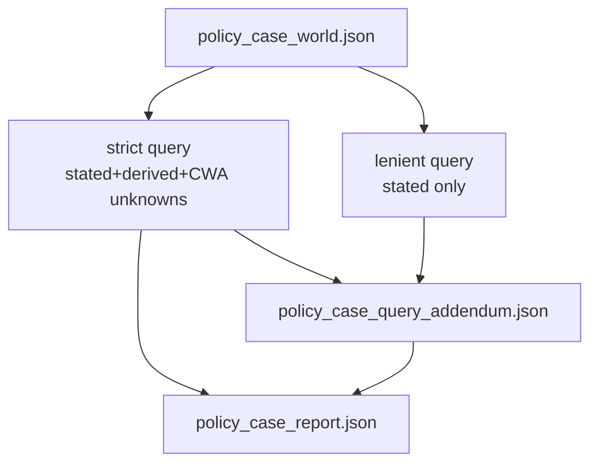

# Dev plan: Policy case dual query — strict (CWA) + lenient (existential completion)

**Status:** Implemented  
**Priority:** P1  
**Prerequisite:** `dev_plan_external_world_tester_v4_policy_world_pipeline_v1.md` (implemented)  
**Package:** `NagV/pivot_pipeline/external_tester/`  
**Depends on:** `policy_query.py`, `world_to_z3.py`, `run.py`, `explainer.py`, `schemas.py`

---

## 1. Vision (one paragraph)

Keep **strict** as the default policy-case verdict: stated + witness-derived + **unknowns → false/0 at query** (pessimistic CWA). On **every** run, also run a **lenient** second query: pin **stated only**, leave **unknown grounded + derived** free, ask whether ∃ values satisfy the full compiled pathway. Emit a **report addendum** (or extended report section) with side-by-side results and, on lenient SAT, **one Z3 witness** showing example values for unknowns (and derived) — labeled as *one* satisfying completion, not ground truth.

---

## 2. Problem / user story

Recruitment-scale runs often show **strict incompatible** while many fields are **unknown**. Operators need:

- **Strict:** “Fails under conservative gap-filling.”
- **Lenient:** “Is there *any* completion consistent with cited facts?”
- **Witness:** “If yes, here is *one* assignment for gaps (and implied derived flags).”

Without lenient, users over-interpret UNSAT as “candidate fails” rather than “evidence + pessimistic defaults are jointly inconsistent.”

---

## 3. Semantics (two queries, one world)

| Mode | ID | Pinned at Z3 | Free at Z3 | Question |
|------|-----|--------------|------------|----------|
| **Strict** (default, unchanged) | `strict` / `cwa_pessimistic_v1` | stated + derived (from world build witness) + unknown→false/0 | nothing | Is this **fully pinned** world compatible? |
| **Lenient** (new, always-on) | `lenient` / `existential_completion_v1` | **stated only** | unknown grounded + **derived** tier | ∃ completion satisfying policy ∧ stated? |

**Agreed design (no second lenient variant):** Do **not** offer stated+derived lenient in v1. Derived are policy outputs; lenient re-derives them jointly with unknowns.

**Relationship to world-builder derive:** Phase-2 `z3_witness` on stated-only remains for populating `policy_case_world.json` → `derived[]` artifact. Lenient query is a **separate** solver pass after trust; it may assign **different** derived values than the world artifact. Report must **not** imply world `derived` equals lenient witness derived.



---

## 4. Design choices

| Question | Choice | Notes |
|----------|--------|-------|
| Default strict | **unchanged** | Primary `compatibility` in main report stays strict |
| Lenient on every run? | **Yes** (default on) | Env `PIVOT_CASE_LENIENT_QUERY=off` to disable |
| Lenient pin set | **stated only** | Per agreed option 1 |
| Lenient SAT witness | **model()** after `check()==sat` | Extract subset for `unknown` + `derived` tiers |
| Lenient UNSAT | **incompatible** | Means “no completion even with free gaps” — strong signal |
| Int bounded box (`varprod`) | **same as strict** | Reuse `build_solver`; box still applied |
| Explain strict UNSAT | **unsat core** (existing) | |
| Explain lenient SAT | **witness slice** in addendum | Optional short note in `explainer`; no duplicate unsat-core pass required for lenient SAT |
| Explain lenient UNSAT | **one line** in addendum | “No satisfying completion exists fixing stated facts” |
| User-facing labels | **strict** / **lenient** | Avoid “pass/fail”; use `compatible` / `incompatible` per mode |
| `block` unknown policy | strict only | Lenient ignores CWA by definition |

---

## 5. Schemas

### 5.1 `PolicyQueryResultV1` — add optional mode field (non-breaking)

```json
{
  "schema_version": "1",
  "query_mode": "strict",
  "z3_status": "unsat",
  "compatibility": "incompatible",
  "defaulted_variables": ["salary_expectation"],
  "default_policy": "cwa_pessimistic_v1"
}
```

Lenient result uses `"query_mode": "lenient"`, `"default_policy": "existential_completion_v1"`, `"defaulted_variables": []`.

### 5.2 New: `PolicyQueryAddendumV1`

Written to `policy_case_query_addendum.json` (and embedded summary in report).

```json
{
  "schema_version": "1",
  "strict": {
    "z3_status": "unsat",
    "compatibility": "incompatible",
    "defaulted_variables": ["..."],
    "default_policy": "cwa_pessimistic_v1"
  },
  "lenient": {
    "z3_status": "sat",
    "compatibility": "compatible",
    "default_policy": "existential_completion_v1",
    "witness_unknown": {
      "salary_expectation": 0,
      "question_is_required": true
    },
    "witness_derived": {
      "answer_submitted": true,
      "meets_support_ops_competency_requirement": true
    },
    "witness_note": "One satisfying completion; not unique and not from document."
  },
  "summary": "strict=incompatible; lenient=compatible (exists completion for gaps)"
}
```

- **`witness_unknown`:** keys ⊆ `world.unknown` (and only grounded unknowns).
- **`witness_derived`:** keys ⊆ derived tier from `variable_tiers` (not only `world.derived` names).
- Optional **`witness_full`:** full catalog model (debug flag only; off by default — large).

### 5.3 `PolicyCaseReportV1` — extend

```json
{
  "compatibility": "incompatible",
  "z3_status": "unsat",
  "lenient_compatibility": "compatible",
  "lenient_z3_status": "sat",
  "query_addendum_path": ".../policy_case_query_addendum.json",
  "dual_query_summary": "strict=incompatible; lenient=compatible"
}
```

Primary fields remain **strict** for backward compatibility.

---

## 6. Implementation

### 6.1 `world_to_z3.py`

| Function | Purpose |
|----------|---------|
| `build_stated_pin_dict(world) -> dict[str, int\|bool]` | Stated values only |
| `build_query_world(...)` | **unchanged** (strict) |
| `build_lenient_pin_dict(world) -> dict[str, int\|bool]` | Alias of stated-only pin input |

### 6.2 `policy_query.py`

| Function | Purpose |
|----------|---------|
| `run_policy_query(...)` | **unchanged** — strict |
| `run_lenient_policy_query(meta, world) -> tuple[PolicyQueryResultV1, dict]` | Pin stated; `_run_sat_with_model` |
| `extract_witness_slices(model, meta, world, tiers) -> (unknown, derived)` | Map Z3 model to named dicts |

**Lenient SAT path:**

1. `solver, aux = build_solver(meta)`
2. `solver.add(_world_to_z3(sym, sorts, stated_pin))` — **only stated keys**
3. `check()` → if `sat`, `model = solver.model()`
4. For each `var` in `world.unknown` + derived tier names: read value via existing `_model_value` helper (move/share from `world_builder.py`)

**Lenient UNSAT:** return incompatible, empty witness objects.

**Early check (optional P2):** If lenient UNSAT, strict may still run (strict can be UNSAT or SAT independently). If stated-only UNSAT, strict is necessarily UNSAT — optional short-circuit log only.

### 6.3 `execute_z3.py` (small extension)

Add `_run_sat_with_model(meta, world_pin) -> tuple[z3_status, model|None, aux]` — refactor `_run_sat` to call it (strict passes full `complete` dict).

### 6.4 `run.py`

After strict query + strict explain:

1. `lenient_result, witness = run_lenient_policy_query(...)`
2. Write `policy_case_query_addendum.json`
3. Merge summary into `policy_case_report.json`
4. Trace: `{"kind": "policy_query_lenient", ...}`

**Order:** strict first (primary), lenient second (cheap).

**Disable:** `PIVOT_CASE_LENIENT_QUERY=off` or `--no-case-lenient-query`.

### 6.5 `explainer.py` (minimal v1)

- Strict explain: **unchanged**
- Lenient: no unsat-core pass in v1 when lenient SAT; addendum carries witness
- Optional P2: one-paragraph `lenient_note` in `policy_case_explanation.json` referencing addendum path

### 6.6 `world_builder.py`

**No change required** for v1. Document that `world.derived` is **illustrative** (pre-query witness) and may differ from lenient `witness_derived`.

---

## 7. Artifacts

| File | Content |
|------|---------|
| `policy_case_query.json` | Strict result only (unchanged) |
| `policy_case_query_addendum.json` | **New** — strict + lenient + summary |
| `policy_case_report.json` | Extended with lenient summary fields |
| `external_tester_run_report.json` | Same alias as today |

---

## 8. CLI / env

| Flag / env | Default |
|------------|---------|
| (implicit) | Lenient **on** every run |
| `--no-case-lenient-query` | Disable lenient pass |
| `PIVOT_CASE_LENIENT_QUERY` | `on` \| `off` |
| `PIVOT_CASE_LENIENT_WITNESS_FULL` | `off` — include full model in addendum |

Strict flags unchanged: `--case-unknown-policy`, etc.

---

## 9. Reporting copy (for UI / logs)

| Pattern | Copy |
|---------|------|
| strict incompatible + lenient compatible | “**Strict:** incompatible under false/0 gaps (N defaulted). **Lenient:** a completion exists; see witness for example gap values.” |
| both incompatible | “**Strict:** incompatible. **Lenient:** no completion exists even allowing free gaps — cited facts may conflict with policy.” |
| both compatible | “**Strict:** compatible. **Lenient:** compatible (witness may differ on gaps).” |

Always footnote: lenient witness is **existential example**, not extracted from document.

---

## 10. Implementation phases

### Phase A — Core lenient query (P0)

- [ ] `build_stated_pin_dict` / `run_lenient_policy_query`
- [ ] `_run_sat_with_model` in `execute_z3.py`
- [ ] `witness_unknown` / `witness_derived` extraction
- [ ] `PolicyQueryAddendumV1` schema + writer
- [ ] Wire in `run.py` after strict query
- [ ] Unit tests: toy policy — stated pins only, unknown free → SAT with witness; strict UNSAT + lenient SAT case

### Phase B — Report + docs (P1)

- [ ] Extend `PolicyCaseReportV1` + `dual_query_summary`
- [ ] Update `external_world_tester_overview.md` dual-query diagram
- [ ] Update `pipeline_e2e_overview.md` stage ⑧ one sentence
- [ ] Recruitment fixture test: assert addendum written; strict/lenient keys present

### Phase C — Polish (P2)

- [ ] Improve unsat-core mapping for strict (orthogonal but helps “why strict failed”)
- [ ] Optional `lenient_note` in explanation.json
- [ ] CLI `--no-case-lenient-query`
- [ ] Compare `world.derived` vs `witness_derived` delta in addendum (debug aid)

---

## 11. Tests (`test_external_tester.py`)

| Test | Assert |
|------|--------|
| `test_lenient_sat_exists_completion` | 2-var policy; stated pins; unknown free → lenient compatible + witness |
| `test_lenient_unsat_when_stated_contradicts` | Stated forces UNSAT even with free vars |
| `test_strict_and_lenient_diverge` | Strict UNSAT (CWA), lenient SAT — recruitment-like toy |
| `test_addendum_written_on_pipeline_mock` | Mock world; both queries run; addendum file exists |

---

## 12. Success criteria

- [ ] Every default pipeline run produces `policy_case_query_addendum.json`
- [ ] Strict `policy_case_query.json` / report primary fields **unchanged**
- [ ] Lenient pins **stated only**; never applies CWA to unknowns
- [ ] Lenient SAT includes `witness_unknown` with ≥1 unknown key when `world.unknown` non-empty
- [ ] Lenient SAT includes `witness_derived` for derived-tier vars from model
- [ ] `dual_query_summary` human-readable in report
- [ ] Docs state lenient ≠ approval; witness is one completion
- [ ] Tests pass; recruitment re-run writes addendum without extra LLM cost

---

## 13. Non-goals (v1)

- Stated+derived lenient variant (sensitivity mode) — deferred
- Interactive UI to edit unknowns from witness
- Proof that witness is “minimal” or “closest to document”
- Multiple witnesses / enumerate all SAT completions
- Changing world-builder derive to match lenient witness
- Pathway-scoped or per-rule lenient queries

---

## 14. Open items (post-v1)

- Sensitivity: “lenient SAT but only if variable X = true?”
- Compare strict defaulted vs lenient witness side-by-side table in narrative LLM
- Resume pipeline skipping phase-1 when `policy_case_world.json` fresh

---

*End of plan.*
